<p align="center">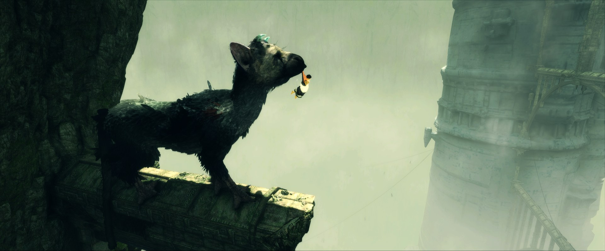</p>

<h1 align="center">The Last Guardian for PC<br><sub>The Definitive Edition</sub></h1>

<p align="center">
  <a href="https://github.com/tabnul/the-last-guardian-definitive/releases/latest"></a>
  
  <a href="port/LICENSE"></a>
</p>

A native Windows and Linux port of The Last Guardian (PS4). It adds DLSS and FSR, frame generation,
ultrawide support, an optional texture pack and an in-game graphics menu. It also brings back many
things the developers cut or hid in the game's files, which you can't find in any other version:
see [Cut and hidden content](#cut-and-hidden-content) and the [full guide](docs/fun.md).

> **Work in progress:** we are bringing back much more that the developers cut, or that the game
> keeps locked behind its trophies. New finds arrive with each release.

No game files are included. You need your own copy, dumped from your own PS4.

**Contents:** [Get started](#get-started) · [Graphics](#graphics) ·
[Cut and hidden content](#cut-and-hidden-content) · [Sound](#sound) · [Soundtrack](#soundtrack) ·
[Controllers and languages](#controllers-and-languages) · [For testers](#for-testers) ·
[Building](#building) · [Credits](#credits)

## Get started

1. Download the latest build from [Releases](https://github.com/tabnul/the-last-guardian-definitive/releases).
2. Put the game files in one folder: CUSA03627 (US) or CUSA03745 (EU) with update 01.03, about
   25 GB. The full list is in [docs/game-files.md](docs/game-files.md). How to dump your own copy:
   [Dumping your own copy](port/packaging/README-player.md#dumping-your-own-copy).
3. For audio, copy `libSceNgs2.sprx` from your PS4 firmware into `system_lib/` next to the executable.
4. Start the launcher, pick the game folder and press **Play**.

**Save half the disk space (experimental):** the port can play the game straight from one packed file. In the
launcher, under Game folder, press **Pack…** to turn the folder into a `.zar` file (about 26 GB
becomes about 12.5 GB, a few minutes), or **.zar…** to pick one you made before. Only the parts the
game asks for are unpacked, while it plays. Keep the folder until a first start works, then you can
delete it. The trade-off: unpacking while playing costs some CPU time, so loads can take a bit
longer and slower CPUs may see short hitches when the game streams new areas. If you have the
space, a plain folder is still the fastest choice.

You need a Vulkan 1.3 graphics card with at least 6 GB of video memory. DLSS needs an NVIDIA RTX
card and FSR 4 a recent card; FSR 3.1 runs on any card.

**Error 4551 on Windows 11:** Smart App Control blocks programs without a digital signature, and
this port is not signed. Turn it off under Windows Security > App & browser control > Smart App
Control.

| Key | In game |
|---|---|
| Insert (R3 + L2) | The port's menu |
| F8 | Switch between DLSS/FSR and the game's own anti-aliasing |
| F10 | FPS counter |
| F12 | Trico Tricks bar |
| Esc | Release the mouse |

The launcher background comes from your game files. To use your own picture, save it as
`launcher_background.png` or `.jpg` in the `user/` folder.

## Graphics

Press **Insert** in game to change settings while you play; the launcher has the same settings.
Each setting shows what the game originally used and what we recommend.

- **Resolution:** the game renders at your window size, 21:9 and 32:9 included. At 21:9 the menus
  and subtitles are laid out for the wider screen. 32:9 is experimental: some overlays and menus
  are still off.
- **Anti-aliasing and upscaling:** DLSS, FSR 4 or FSR 3.1, using the game's own motion vectors.
  The default renders at full size and replaces the game's SMAA, which removes most of the
  shimmer on feathers, grass and fences. Quality to Ultra Performance render lower for more FPS,
  while menus and subtitles stay sharp. **F8** switches back to the game's own AA to compare.
  See [port/docs/upscaling.md](port/docs/upscaling.md) and [docs/dlaa.md](docs/dlaa.md).
- **Frame generation:** DLSS (RTX 40 or newer) or FSR 3.1 (any card). It shows one generated frame
  between each pair of real ones, and works with any upscaler setting, the game's own (Built-in)
  included. It needs a game frame rate above 30, so it is off at 30 FPS. Off by default.
- **Frame rate:** 30 (as on PS4), 60 or unlocked. On an RTX 5090, unlocked runs at about 90-120 FPS.
- **Steam Deck (experimental):** a graphics preset in the launcher, next to Stock and
  Recommended, sets the game up for a Steam Deck: 1280x800, 30 FPS, no upscaling, frame
  generation off, and every graphics setting at Stock (as on PS4). It is new and still being tuned: tell us how it runs.
- **Shader stutter:** shaders are prepared at start from shader recipes (from
  [bloodborne_pc](https://github.com/deadinside28/bloodborne_pc) by @deadinside28), so new
  drivers and updates don't bring the stutter back.
- **Wind and grass:** the stock wind looks like a storm on PC. You can set it separately for the
  boy, the trees and Trico; 50% is a breeze. Grass that the game moved only every 4th frame now
  moves every frame, which stops the flicker.
- **Texture pack (optional):** [ps4-texturepack-generator](https://github.com/tabnul/ps4-texturepack-generator)
  makes a 4x texture pack from your own copy. It can be switched on and off while you play. See
  [docs/texture-pack.md](docs/texture-pack.md).

The in-game menu also has:

| | |
|---|---|
| Presets | Stock, Recommended (default) and your own, shareable as a `.json` file |
| Shadows | 2048, 4096 or 8192 shadow maps |
| Camera | Field of view from 50 to 110 degrees |
| Effects | Ambient occlusion, bloom, reflections, motion blur, vignette, sharpening, fog |
| Textures | LOD bias, anisotropic filtering up to 16x |
| Colour | Brightness, contrast, saturation, gamma, HDR10 |
| Menu buttons | [Cross or Circle to confirm](docs/menu-buttons.md) |
| Japanese text | Experimental, EU CUSA03745 1.03 only, see [docs/japanese.md](docs/japanese.md) |

Settings that made no visible difference were left out; see
[docs/graphics-investigation.md](docs/graphics-investigation.md).

<details>
<summary>Screenshots: stock vs this port</summary>

Both at 3840x1600, first with the game's own settings, then with this port's defaults. Click for
the full screenshot. Most of the difference is in motion (less shimmer), which a still can't show.

*Trico's face:*

[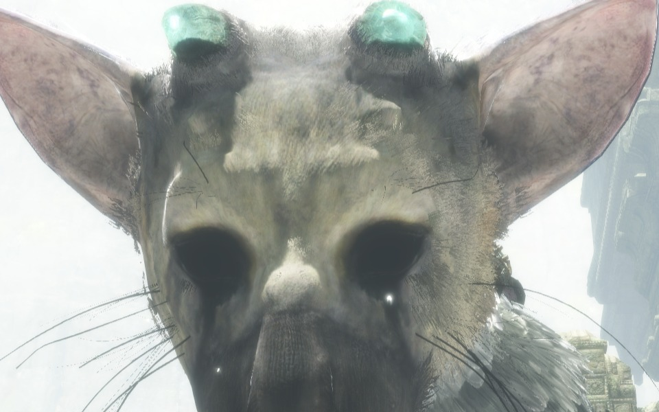](docs/screenshots/TRICO_STOCK.png)
[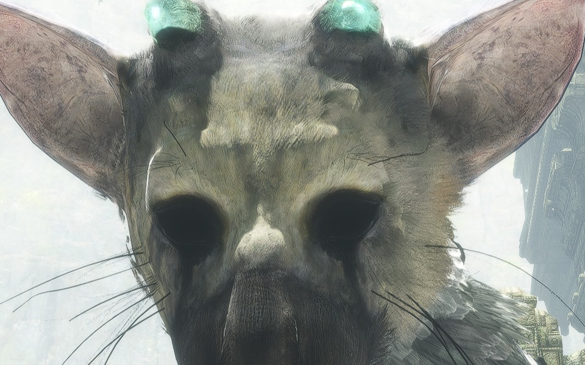](docs/screenshots/TRICO_AFTER.png)

*Cave courtyard, grass and the boy* ([stock](docs/screenshots/CAVE_STOCK.png) · [modded](docs/screenshots/CAVE_AFTER.png)):

[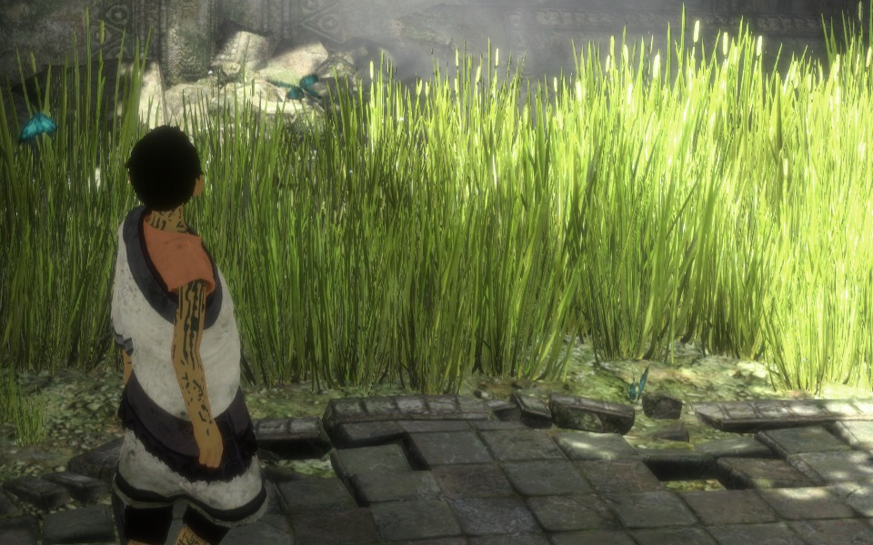](docs/screenshots/CAVE2_STOCK.png)
[](docs/screenshots/CAVE2_AFTER.png)

*Texture pack, stone slab and moss, original then with the pack:*

[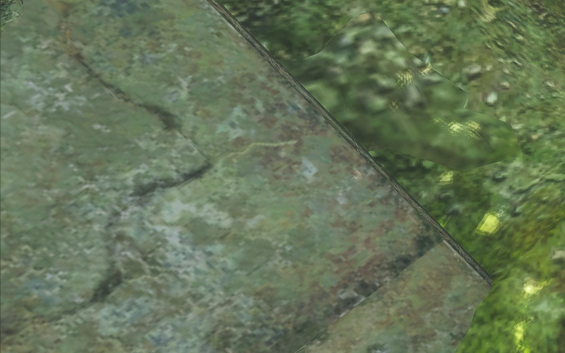](docs/screenshots/TEXTURE_STOCK.png)
[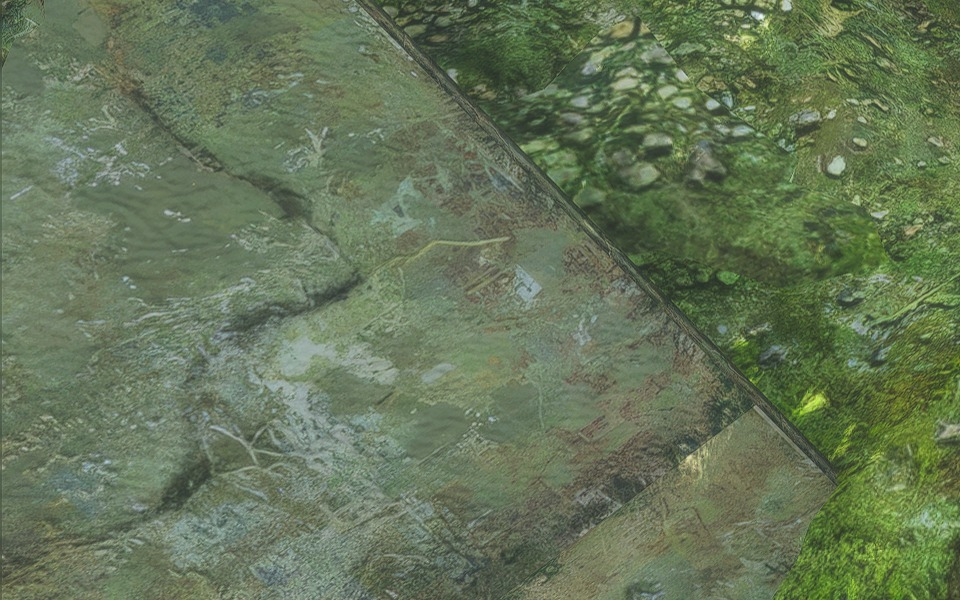](docs/screenshots/TEXTURE_AFTER.png)

[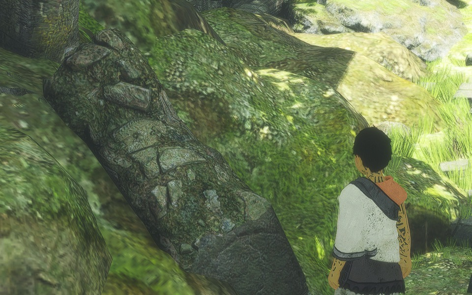](docs/screenshots/TEXTURE_STOCK.png)
[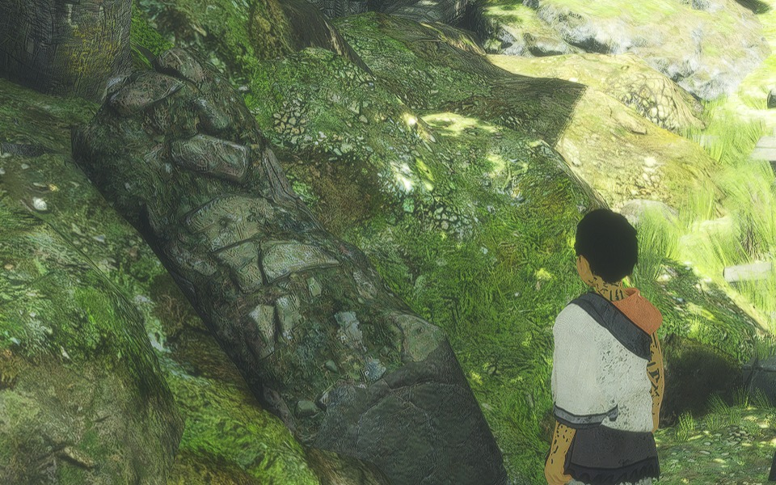](docs/screenshots/TEXTURE_AFTER.png)

</details>

## Cut and hidden content

The game's scripts still contain things the developers built and then switched off or kept for
themselves. This port turns them back on. You won't find them in any other version of the game.
They are in the in-game menu (**Insert**, the **Fun** and **Trico Tricks** tabs).

> **[Read the full guide: everything we found and how to use it →](docs/fun.md)**

**Trico's drool.** The developers made it: the drool thickens when Trico smells something he
wants and thins out when he loses interest. Just before release it was switched off with one line
that is still in `condorcommonslaver.lua`:

```lua
	-- 一旦よだれを消してくれということなので消しておく
	do return end
```

*"We've been asked to get rid of the drool for now, so I'm getting rid of it."* You can set it to
**As the developers planned** or **Always**, in the launcher's Settings page or the Fun tab.

<p align="center"><a href="docs/fun.md#tricos-drool">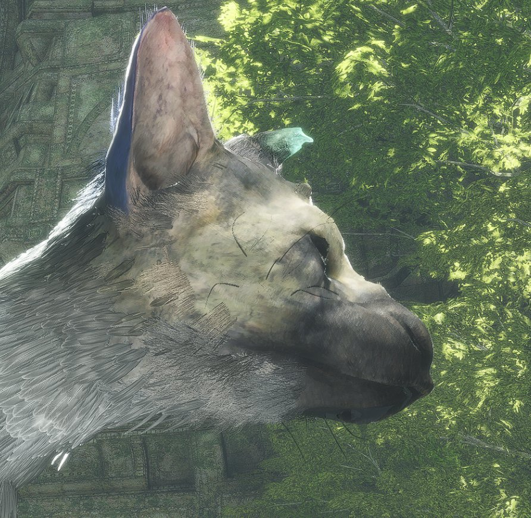</a> <a href="docs/fun.md#tricos-drool">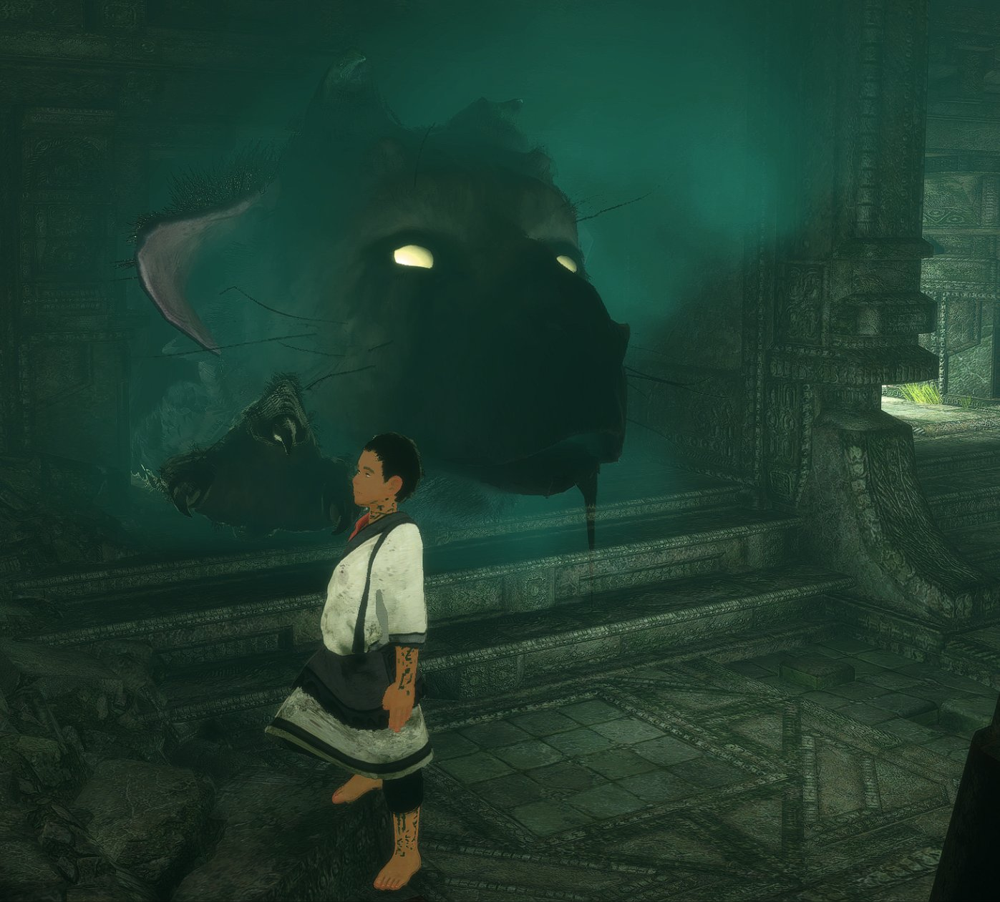</a></p>

**Trico's toilet.** Trico does need to go, but the game's scripts make sure you almost never see
it. He has to have eaten enough barrels, then 30 minutes of play must pass, then he waits until
the boy is more than 10 metres away and Trico's head has been out of the camera's view for 3
seconds. Look at him and the wait starts over. Most players only ever find the green dung balls
later, and the boy can pick them up and carry them. **Toilet** in the Trico Tricks tab skips all of
that: he goes right away, in front of you.

<p align="center"><a href="docs/fun.md#tricos-toilet">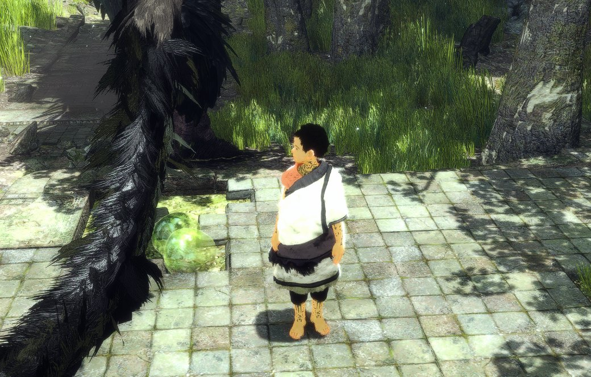</a> <a href="docs/fun.md#tricos-toilet">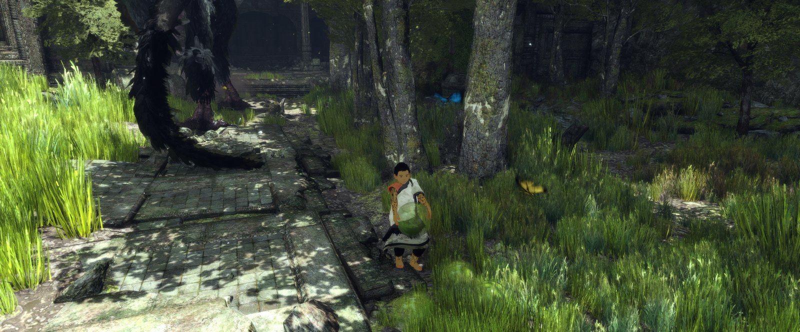</a></p>

The rest:

- **Trico Tricks** (**F12**): a bar with 30 of Trico's own moves, such as yawn, sneeze, roar, sit
  and roll over, plus the throw-up animation the developers sealed in July 2016. More moves are
  in the menu, but some of them may not work. Trico doesn't always listen.
- **Extra Tricos**: up to 8 more, including the armoured one.
- **Size:** from half to twice his size.
- **Eyes:** the hidden disco-eye effect, or any colour.
- **Free camera:** the developers' own camera.
- **Tricopilot:** the developers' test tool where Trico walks around by himself and the camera
  follows him.

<table>
  <tr>
    <td><a href="docs/fun.md#extra-tricos">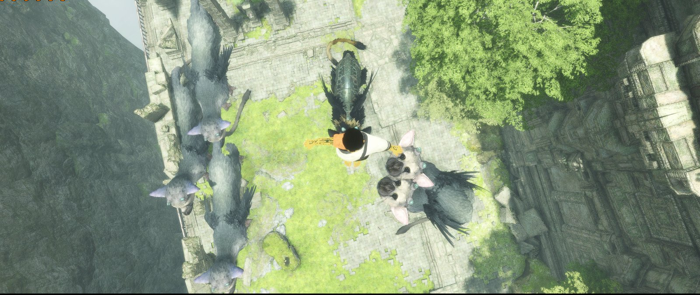</a></td>
    <td><a href="docs/fun.md#trico-tricks-make-trico-move">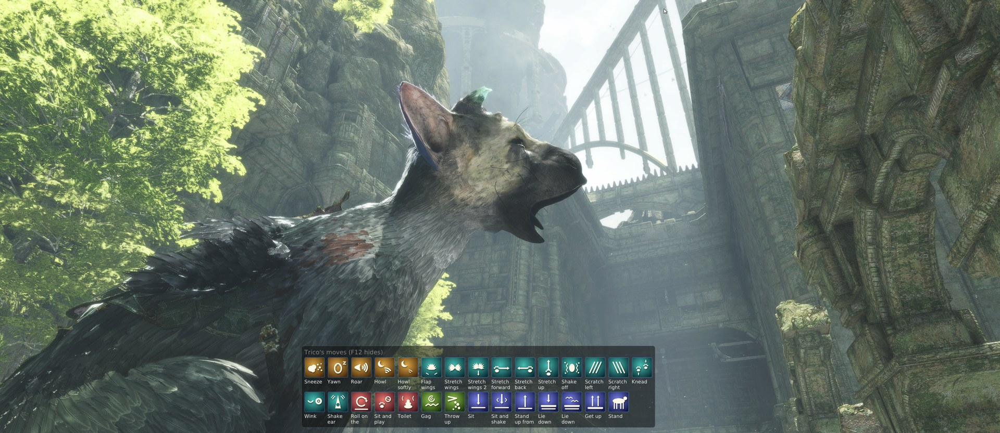</a></td>
    <td><a href="docs/fun.md#tricos-size">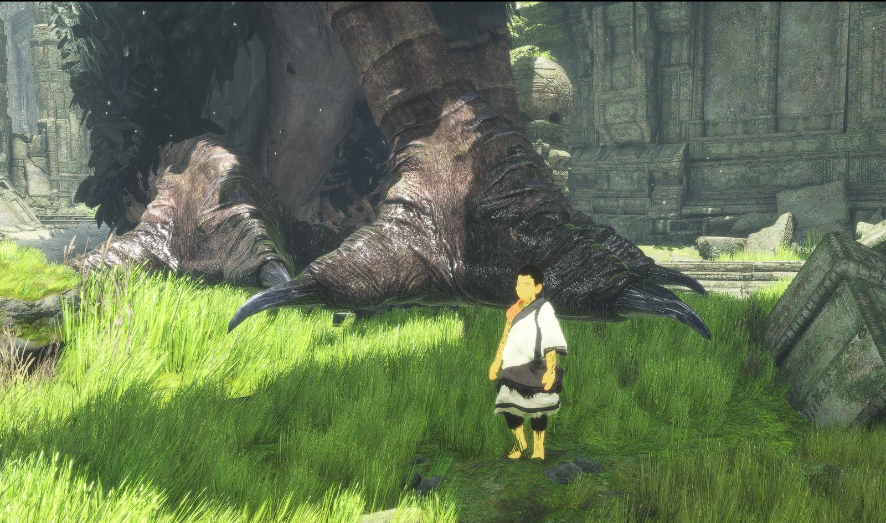</a></td>
  </tr>
  <tr>
    <td><a href="docs/fun.md#extra-tricos">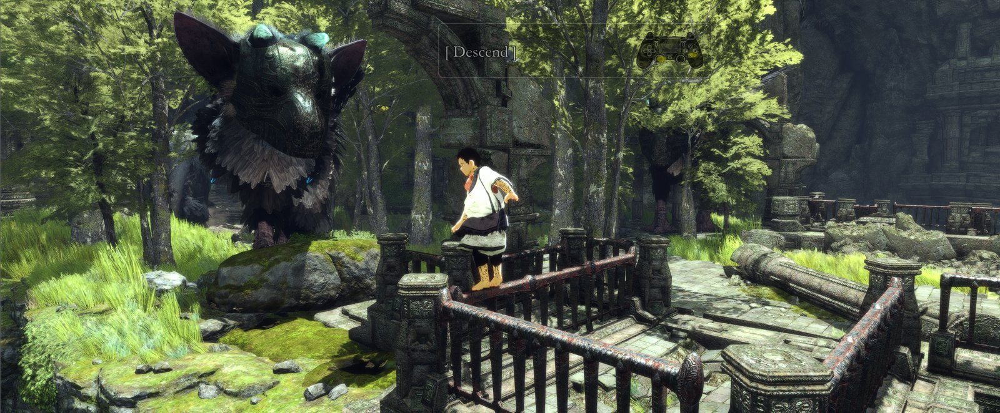</a></td>
    <td><a href="docs/fun.md#tricos-eyes">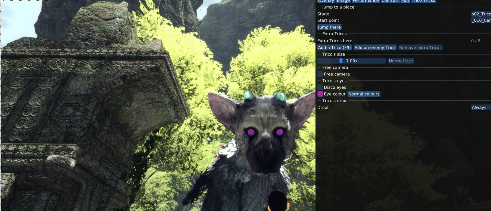</a></td>
    <td><a href="docs/fun.md#tricos-size">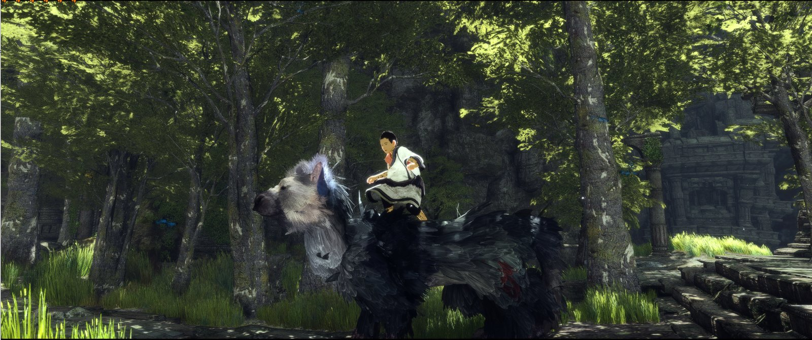</a></td>
  </tr>
</table>

**More is coming.** We are working on bringing back much more: content the developers cut, and
extras the game keeps locked behind its trophies.

<p align="center"><b><a href="docs/fun.md">More pictures, the full story behind each find, and how to use them: docs/fun.md</a></b></p>

## Sound

The game mixes in 7.1. Set Windows (or your Linux sound server) to 5.1 or 7.1 and every channel
goes to its own speaker; on a stereo device you get a stereo mix-down. In the launcher (Settings,
Audio) or the in-game menu (Controls, Sound) you can pick the **output device** and turn on
**Always send 7.1**: then a stereo headset gets all 8 channels, so Windows Sonic or Dolby Atmos for
Headphones turn them into headphone surround. Both apply at the next start.

## Soundtrack

The launcher's **Soundtrack** page plays all of the game's music from your own game files: 100
pieces, about 110 minutes, sorted by the stage where they play. Takeshi Furukawa's score was
recorded by the London Symphony Orchestra, London Voices and the Trinity Boys Choir. The music is
stored in surround, so you can choose 5.1 or a stereo mix-down. See [docs/soundtrack.md](docs/soundtrack.md).

<p align="center">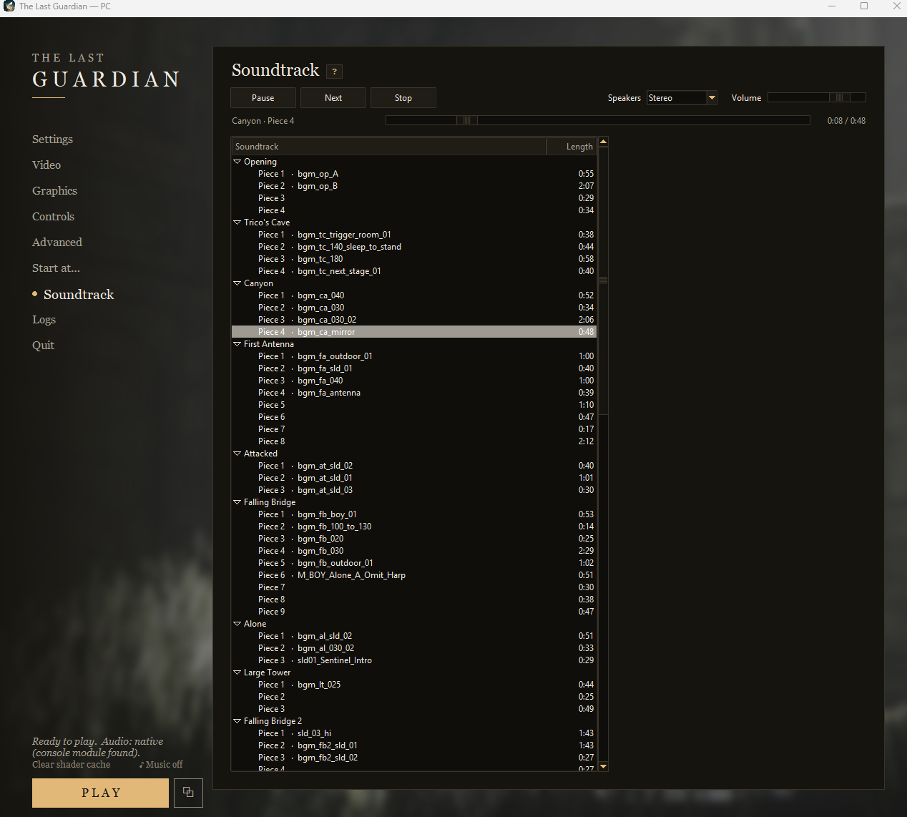</p>

## Controllers and languages

DualSense, DualShock 4 and Xbox controllers work out of the box, including rumble and the motion
sensor. On the launcher's **Controls** page you can remap buttons, set stick dead zones and
trigger points, check for stick drift, and remap keyboard and mouse. See
[port/packaging/README-player.md](port/packaging/README-player.md).

<p align="center">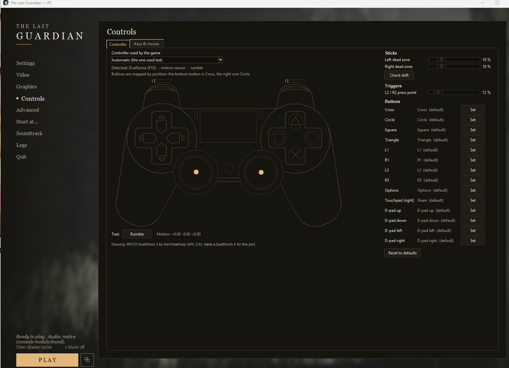</p>

The launcher and in-game menu are in English, with language packs for German, French, Spanish,
Brazilian Portuguese, Japanese and Simplified Chinese (**Settings > Language**). The Portuguese
pack is HayatoG's translation. The others are machine translations, and corrections from native
speakers are welcome; see [port/docs/language-packs.md](port/docs/language-packs.md). The game's
own text and voices are a separate setting.

## For testers

- **Jump to any scene:** over 200 start points, from the first cave to the credits. Pick one on
  the launcher's **Start at…** page (your saves are copied first and put back afterwards), or in
  game under Fun > *Jump to a place*.
- **Level select and QA menu:** tick *Level select and QA menu* under Debug in the launcher. For
  level select, hold L1 while the title menu closes. For the QA menu, hold L1 and press L3 in game
  (keyboard: hold 1, press Z). Based on the GoldHEN patch by @illusionyy and @DanielSvoboda; this
  port fixes the black screen and the video memory running out after a few stage switches. Their
  collapsing-bridge freeze fix is always on.
- **Scene check:** a script that visits all 219 start points and records FPS and a screenshot of
  each. See [docs/scene-check.md](docs/scene-check.md).

## Building

```bash
git clone --recursive https://github.com/tabnul/the-last-guardian-definitive.git && cd the-last-guardian-definitive
cd port && TLG_LTO=OFF bash build.sh
```

On Windows, run this in an MSYS2 CLANG64 shell; see
[port/packaging/windows/README.md](port/packaging/windows/README.md). DLSS also needs the DLSS SDK
(`build_dlss.sh`).

## Credits

Thanks to everyone whose work this builds on.

- [HayatoG/tlg_pc](https://github.com/HayatoG/tlg_pc): the original port. The loader, the
  runtime and most of what makes the game run at all is HayatoG's work.
- [gow3_pc](https://github.com/FelipePrado0/gow3_pc), [bloodborne_pc](https://github.com/deadinside28/bloodborne_pc)
  and the [shadPS4](https://github.com/shadps4-emu/shadPS4) video core.
- @illusionyy and @DanielSvoboda: the GoldHEN level select, QA menu and bridge fix patches.
- [kanjieater](https://github.com/kanjieater): Cross/Circle menu confirmation and the EU 1.03
  Japanese text option.
- Mike Lothian ([@FireBurn](https://github.com/FireBurn)): [UniversalScalers-Vulkan](https://github.com/FireBurn/UniversalScalers-Vulkan),
  which FSR 3.1, FSR 4 and FSR frame generation run on, and the open FSR 4 model files from his
  [Q2RTX](https://github.com/FireBurn/Q2RTX) builds (AMD FidelityFX SDK, MIT).
- Felipe Prado ([@FelipePrado0](https://github.com/FelipePrado0)): shipping the FSR 4 model in the
  packages follows his [SpartanPort](https://github.com/FelipePrado0/SpartanPort).
- Lucas Emiliano ([@devLucasEmiliano](https://github.com/devLucasEmiliano)): the start-up fix for
  DLLs loaded in the PS4 address range ([SpartanPort #1076](https://github.com/FelipePrado0/SpartanPort/pull/1076)).
- [LibAtrac9](https://github.com/Thealexbarney/LibAtrac9) for audio, and
  [vgmstream](https://github.com/vgmstream/vgmstream) for the sound bank layout.
- [4x-UltraSharp](https://huggingface.co/Kim2091/UltraSharp) by Kim2091 (CC BY-NC-SA 4.0), the
  default texture upscale model, and Microsoft's [DirectXTex](https://github.com/microsoft/DirectXTex).
- NVIDIA DLSS, under the NVIDIA DLSS license.
- Packed games (.zar): [ZArchive](https://github.com/Exzap/ZArchive) by Exzap (MIT-0), and the
  idea and design from [@R-V-L](https://github.com/R-V-L)'s ZArchive build of
  [gow3_pc](https://github.com/R-V-L/gow3_pc). Thanks to @dwaynevn-git for asking for it (#72).
- The controller drawing: the [RPCS3](https://github.com/RPCS3/rpcs3) DualShock 3 drawing by
  HerrHulaHoop (GPL-2.0), redrawn as a DualShock 4.

## License

GPL-2.0, see [port/LICENSE](port/LICENSE).

This is an unofficial fan project. Sony Interactive Entertainment, SIE Japan Studio and genDESIGN
did not make, approve or sponsor it. "The Last Guardian" is a trademark of Sony Interactive
Entertainment. "The Definitive Edition" is our name for this port, not an official release. No
game code, files or art are included.
