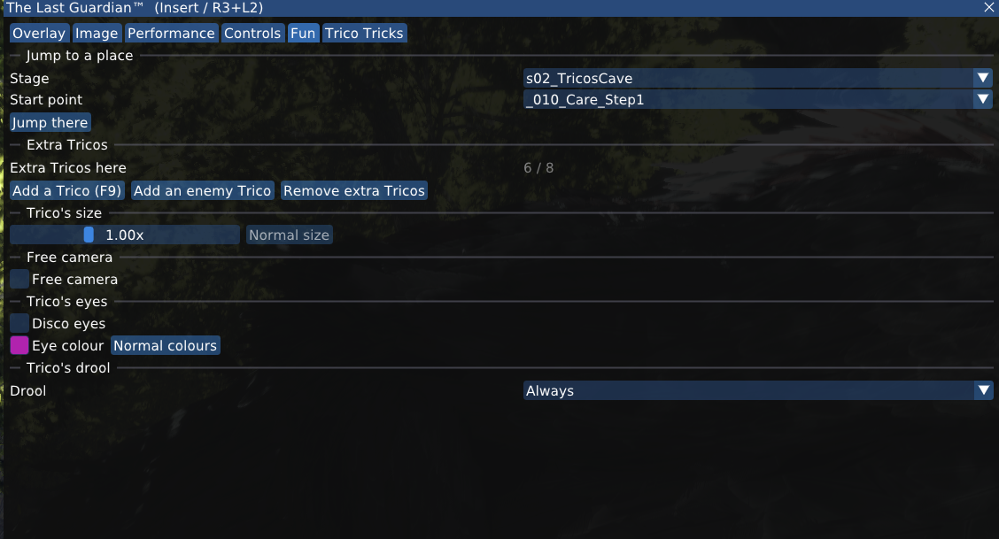
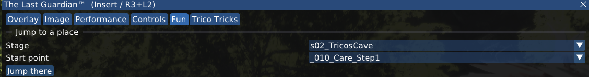

<p align="center"></p>

<h1 align="center">The Last Guardian for PC</h1>

<p align="center">
  <b>The best way to enjoy Fumito Ueda's masterpiece on PC.</b><br>
  <i>By fans, for fans.</i><br>
  A native port for Windows and Linux: DLAA and FSR 3.1, frame generation, the complete orchestral soundtrack, widescreen, optional AI-upscaled textures,<br>
  high frame rates without shader stutter.<br>
  <b>Unique features: content the developers cut, and easter eggs they left
  behind, brought back to life.</b>
</p>

<p align="center">
  <a href="https://github.com/tabnul/tlg_pc/releases/latest"></a>
  
  <a href="https://github.com/tabnul/tlg_pc/issues"></a>
  <a href="port/LICENSE"></a>
</p>

<p align="center">
  <a href="#the-complete-soundtrack">Soundtrack</a> ·
  <a href="#spotlight-trico-tricks">Trico Tricks</a> ·
  <a href="#cut-by-the-developers-brought-back">Cut content</a> ·
  <a href="#spotlight-tricos-drool">Trico's drool</a> ·
  <a href="#features">Features</a> ·
  <a href="#stock-vs-modded">Stock vs modded</a> ·
  <a href="#fun">Fun</a> ·
  <a href="#get-started">Get started</a> ·
  <a href="#building">Building</a> ·
  <a href="#credits">Credits</a>
</p>

> No game files are included. You need your own copy, dumped from your own PS4.

[](https://www.youtube.com/watch?v=16rYLJlGy6A)

## Why this port

- ✨ **Unique.** Features you will not find on PS4 or anywhere else: cut content and hidden
  developer tools found in the game's own files and switched back on.
- 🎨 **Beautiful.** DLAA (NVIDIA) or FSR 3.1 (any graphics card) removes the shimmer on feathers,
  foliage and fences. Add sharper shadows,
  a calmer wind and an optional AI-upscaled 4x texture pack.
- 🎵 **The full soundtrack.** All 110 minutes of the score in the launcher, in stereo or 5.1
  surround.
- 🐉 **Trico Tricks.** Make Trico yawn, sneeze, roar, stretch, roll over or sit with one click: 30
  moves on a bar over the game (**F12**), plus the throw-up the developers cut.
- 🚀 **Fast.** About 90-120 FPS unlocked on an RTX 5090, no freezes in play, and shaders ready in
  under a second at start.
- 🛠️ **Well supported.** 19 releases since October 2026, crash reports followed up, and fixes
  shipped within days. Windows and Linux builds.
- 🐾 **Fun.** Trico's drool, a giant or tiny Trico, extra Tricos, disco eyes, a free camera and
  Tricopilot: Trico driving himself.
- ⚙️ **Yours to tune.** Nearly every setting changes live in game, and each one says what the game
  originally used and what we recommend.

## Graphics and performance

### Any resolution, ultrawide

- The game renders at the window's resolution, 21:9 and 32:9 included.
- At 21:9, menus, hints and subtitles are laid out for the wider screen instead of stretched.
- 32:9 is experimental: some overlays sit to the left and parts of the menus are stretched.

### DLAA and FSR 3.1 AA

- NVIDIA's DLSS anti-aliasing at native resolution, fed with the game's own motion vectors.
- Replaces the game's SMAA and removes most of the shimmer on foliage, feathers and fences.
- On by default on RTX cards. **FSR 3.1 Native AA** does the same on any card.
- **F8** switches between your choice and the original SMAA. More in [docs/dlaa.md](docs/dlaa.md).

### Frame generation

- DLSS frame generation (RTX 40 or newer) or FSR 3.1 frame generation (any brand).
- Adds one generated image per game frame, so twice the frames are shown.
- Off by default. Tested on an RTX 5090 on Windows.

### Optional AI-upscaled textures

- [ps4-texturepack-generator](https://github.com/tabnul/ps4-texturepack-generator) turns the
  textures of your own copy into a 4x pack (colour textures and normal maps).
- Loaded while the game runs, switchable live. Runs on NVIDIA, AMD/Intel or, slowly, the CPU.
- Entirely optional. More in [docs/texture-pack.md](docs/texture-pack.md).

### Smooth, no shader stutter

- Play at 30, 60 or unlocked: about 90-120 FPS unlocked on an RTX 5090, with no freezes in play.
- Updates and new drivers no longer bring the stutter back: 75% fewer hitches, and the worst
  freezes cut from 630 ms to about 160 ms right after the shader cache was cleared.
- Shaders are prepared in under a second at start, thanks to the shader recipes from
  [bloodborne_pc](https://github.com/deadinside28/bloodborne_pc) by @deadinside28.

### Realistic wind, less flicker

- The stock wind makes the boy's clothes, the trees and Trico's feathers thrash as if in a storm.
  Set the wind separately for the boy, the trees and Trico. The recommended 50% is a breeze.
- The game moves most grass only every 4th frame, which flickers at PC frame rates. Here it moves
  every frame.

### Live graphics menu

Press **Insert** in game and change the picture while you play. The launcher has the same settings.

| | |
|---|---|
| **Presets** | *Stock*, *Recommended* (default) and your own; share them as a `.json` file |
| **Shadows** | 2048, 4096 or 8192 maps: far less shimmer in tree and leaf shadows |
| **Camera** | Field of view from 50 to 110 degrees |
| **Game effects** | Ambient occlusion, bloom, reflections, motion blur, vignette, sharpening, fog: 0-100%+ |
| **Textures** | LOD bias, anisotropic filtering up to 16x, live texture pack switching |
| **Scaling** | FSR 1, AMD CAS or RCAS sharpening |
| **Colour** | Brightness, contrast, saturation, gamma; HDR10 output |
| **Frame rate** | 30 (as on PS4), 60 or unlocked; frame queue depth |
| **Menu buttons** | [Cross or Circle to confirm](docs/menu-buttons.md), gameplay buttons untouched |
| **Japanese text** | Experimental, on EU CUSA03745 1.03: see [docs/japanese.md](docs/japanese.md) |

Every setting shows the value the game originally used and says what we would pick and why. Settings
that made no visible difference were left out; the evidence is in
[docs/graphics-investigation.md](docs/graphics-investigation.md).

## The complete soundtrack

The music of The Last Guardian is a masterpiece of its own. Takeshi Furukawa composed, orchestrated
and conducted it, and it was recorded by the **London Symphony Orchestra**, **London Voices** and the
**Trinity Boys Choir** at Lyndhurst Hall, AIR Studios, London. In the game you hear it in pieces,
under the action. The launcher's **Soundtrack** page lets you sit back and listen to every piece of
music the game has, straight from your own game files:

- 🎼 **100 pieces, about 110 minutes**, grouped by the stage where they play, from the opening to
  the end credits. The game's own working names are shown where it has them.
- 🔊 **In surround, as mixed for the game.** The music is stored in 4 and 6 channels. Choose
  **5.1 surround** for a surround set, or **Stereo** for a proper mix-down to two speakers or
  headphones.
- ⏯️ Play, pause, skip, a volume slider and a progress bar to jump to any moment. Switching
  speakers keeps playing from the same spot.
- 📀 Nothing of the game is shipped: the page reads your copy, so every region and language works.

<p align="center"></p>

More in [docs/soundtrack.md](docs/soundtrack.md).

## Spotlight: Trico Tricks

Ask Trico to yawn, sneeze, roar, stretch, scratch, roll over, sit or lie down, whenever you like.
Press **F12** in game and a bar with all his moves appears over the picture: one click and he does
it, using the game's own animations and the same commands the story uses.

<p align="center"><a href="docs/fun.md#trico-tricks-make-trico-move"></a></p>

- 🐉 **30 moves** on the bar, from *Sneeze* and *Howl softly* to *Knead*, *Wink* and *Shake ear*.
- 🤢 **Throw up:** a cut animation, sealed by the developers in July 2016, brought back.
- 🧪 More moves in the in-game menu that **may not work**: Groom, Fall asleep, Play in the mud and
  others. Try them.

Trico is still Trico: he may take a few tries, or decide he has better things to do.

## Cut by the developers, brought back

The game's files still hold things the developers built and then switched off, hid or left for
their own use. We dug through the game's scripts, found them, and made them playable again:

| | Found in the game | Status at release | In this port |
|---|---|---|---|
| 💧 | [Trico's drool](#spotlight-tricos-drool) | Cut just before release, "for now" | Back on, as planned or always |
| 🤢 | [Trico throwing up](#spotlight-trico-tricks) | Sealed by the developers, July 2016 | Back, one click |
| 🌈 | [Disco eyes](docs/fun.md#tricos-eyes) | Hidden effect, only in a few story moments | Any time, or any colour |
| 🎥 | [Free camera](docs/fun.md#free-camera) | Developers only | In the Fun tab |
| 🤖 | [Tricopilot](docs/fun.md#tricopilot) | Developers' soak-test tool, switched off | Start it yourself |
| 🐾 | [Extra and armoured Tricos](docs/fun.md#extra-tricos) | Developers' own commands | **F9**, up to 8 |
| 🗺️ | [Level select and QA menu](#level-select-and-qa-menu) | Developers' test menus | Working |

## Spotlight: Trico's drool

The developers gave Trico drool. They built the model, the material and the logic: the drool
thickens while Trico smells something he wants and thins out when he loses interest. Then, just
before release, someone asked for it to go. This is the line that removed it, still in the game's
script today (`condorcommonslaver.lua`):

```lua
	-- 一旦よだれを消してくれということなので消しておく
	do return end
```

*"We've been asked to get rid of the drool for now, so I'm getting rid of it."*

"For now" lasted until this port. One early `return` stopped the code just before it shows the
drool, and everything after it never ran. Turn it back on in the launcher's **Settings** page or the
in-game **Fun** tab: **Always**, or **As the developers planned**.

<p align="center"><a href="docs/fun.md#tricos-drool"></a> <a href="docs/fun.md#tricos-drool"></a></p>

## Features

| | Feature | What you get |
|---|---|---|
| 🎨 | [DLAA and FSR 3.1 AA](#dlaa-and-fsr-31-aa) | Clean, stable edges, no shimmer |
| 🎞️ | [Frame generation](#frame-generation) | DLSS or FSR 3.1: twice the frames shown |
| 🚀 | [Smooth, no shader stutter](#smooth-no-shader-stutter) | 30, 60 or unlocked; shader recipes |
| 🖥️ | [Any resolution, ultrawide](#any-resolution-ultrawide) | 21:9 with menus laid out for it |
| 🧱 | [Optional AI-upscaled textures](#optional-ai-upscaled-textures) | A 4x texture pack made from your own copy |
| 🍃 | [Realistic wind, less flicker](#realistic-wind-less-flicker) | A breeze instead of a gale, grass that moves every frame |
| 🎛️ | [Live graphics menu](#live-graphics-menu) | Presets, shadows, FOV, effects, colour, HDR |
| 📍 | [Jump to any scene](#jump-to-any-scene) | Start anywhere, from the launcher or in game |
| 🗺️ | [Level select and QA menu](#level-select-and-qa-menu) | The developers' own menus, fixed |
| 🐾 | [Fun](#fun) | Drool, Trico tricks, size, extra Tricos, free camera, Tricopilot |
| 🎵 | [Soundtrack](#the-complete-soundtrack) | All 110 minutes of the game's music, in stereo or 5.1 |
| 🎮 | [Controllers](#controllers) | DualSense, DualShock 4, Xbox, keyboard and mouse |
| 🔬 | [Scene check](#scene-check) | Test all 219 scenes in one run |

## Stock vs modded

The same spot, first with the game's own settings, then with this port's defaults. Both are in
widescreen at 3840x1600, so even the stock shot is already beyond the PS4. Click a picture for the
full screenshot.

> The biggest changes are in motion: stable edges on foliage, feathers and fences, and no shimmer.
> They can only be properly seen in game.

*Trico's face at 100%, stock then modded:*

[](docs/screenshots/TRICO_STOCK.png)
[](docs/screenshots/TRICO_AFTER.png)

<details>
<summary><b>More comparisons:</b> cave, grass, texture pack</summary>

**Cave**: [stock](docs/screenshots/CAVE_STOCK.png) · [modded](docs/screenshots/CAVE_AFTER.png)

*Cave courtyard, grass and the boy at 100%, stock then modded:*

[](docs/screenshots/CAVE2_STOCK.png)
[](docs/screenshots/CAVE2_AFTER.png)

*Texture pack, stone slab at 100%, original then with the pack:*

[](docs/screenshots/TEXTURE_STOCK.png)
[](docs/screenshots/TEXTURE_AFTER.png)

*Texture pack, moss and rock at 100%, original then with the pack:*

[](docs/screenshots/TEXTURE_STOCK.png)
[](docs/screenshots/TEXTURE_AFTER.png)

</details>

## Fun

Unique to this port: content the developers cut, easter eggs they left behind, and a Trico you can
boss around. All of it is in the
in-game menu (**Insert**, the **Fun** and **Trico Tricks** tabs). Everything is explained in
**[docs/fun.md](docs/fun.md)**.

<p align="center"></p>

<table>
  <tr>
    <td><a href="docs/fun.md#tricos-size"></a></td>
    <td><a href="docs/fun.md#extra-tricos"></a></td>
    <td><a href="docs/fun.md#tricos-drool"></a></td>
  </tr>
  <tr>
    <td><a href="docs/fun.md#tricos-size"></a></td>
    <td><a href="docs/fun.md#extra-tricos"></a></td>
    <td><a href="docs/fun.md#tricos-eyes"></a></td>
  </tr>
  <tr>
    <td><a href="docs/fun.md#tricos-toilet"></a></td>
    <td><a href="docs/fun.md#tricos-toilet"></a></td>
    <td><a href="docs/fun.md#trico-tricks-make-trico-move"></a></td>
  </tr>
</table>

- 💧 [**Trico's drool**](#spotlight-tricos-drool): cut just before release with one line of code,
  back on. Also in the launcher, on the Settings page.
- 🐉 [**Trico Tricks**](#spotlight-trico-tricks): sneeze, roar, sit, roll, groom
  and more, plus the cut throw-up. **F12** puts the moves on a bar over the game.
- 💩 [**Trico's toilet**](docs/fun.md#tricos-toilet): Trico relieves himself on command. In the
  game it almost never happens where you can see it: he waits until you look away.
- 📏 [**Trico's size**](docs/fun.md#tricos-size): from half to twice his size.
- 🐾 [**Extra Tricos**](docs/fun.md#extra-tricos): up to 8 more, the armoured one too (**F9**).
- 🌈 [**Trico's eyes**](docs/fun.md#tricos-eyes): disco eyes or any colour you like.
- 🎥 [**Free camera**](docs/fun.md#free-camera): the developers' own camera.
- 🤖 [**Tricopilot**](docs/fun.md#tricopilot): Trico drives himself and the camera follows him —
  the developers' own tool for leaving the game running by itself. The launcher's benchmark can
  keep it on for a whole run.
- 📍 [**Jump to a place**](#jump-to-any-scene): any stage, any start point, in game or
  from the launcher.

### Jump to any scene

Start any of the game's stages at any of its start points: over 200 places, from the first cave to
the end credits. Replay a favourite moment, or test a setting in exactly the right spot.

- **From the launcher:** the **Start at…** page starts the game right at the chosen point. Your
  saves are copied first and put back when the game closes, so your own playthrough is untouched.
- **In game:** the **Fun** tab, *Jump to a place*: pick a stage and a start point and press
  **Jump there**, no restart needed.

<p align="center"></p>

### Level select and QA menu

The PS4 game still contains the developers' level select and QA menu. Tick *Level select and QA
menu* under Debug in the launcher.

- **Level select:** hold L1 while the title menu closes and pick any chapter.
- **QA menu:** in game, hold L1 and press L3 (keyboard: hold 1, press Z), then jump to any stage.

Based on the GoldHEN "Level Select + QA Menu" patch by @illusionyy and @DanielSvoboda. On its own,
that patch's stage switch leaves a black screen and runs out of video memory after a few jumps;
this port fixes both. Their *collapsing bridge freeze fix* is always on.

### Scene check

For testers and developers: a script visits all 219 start points, measures the FPS of every second
and takes a screenshot of each. Run it before and after a change. More in
[docs/scene-check.md](docs/scene-check.md).

## Get started

1. **Download** the latest build from [Releases](https://github.com/tabnul/tlg_pc/releases).
2. **Game files:** CUSA03627 (US) or CUSA03745 (EU) with update 01.03, in one folder (about 25 GB).
   The full list is in [docs/game-files.md](docs/game-files.md).
3. **Audio:** put the PS4 firmware's `libSceNgs2.sprx` in `system_lib/` next to the executable.
4. **Play:** start the launcher, pick the game folder and language, and press **Play**.

**PC:** a Vulkan 1.3 graphics card with 6 GB of video memory or more. DLAA needs an NVIDIA RTX
card; FSR 3.1 AA runs on any card.

| Key | In game |
|---|---|
| Insert (R3 + L2) | The port's menu |
| F8 | DLAA or FSR 3.1 / original SMAA |
| F9 | Add a Trico |
| F10 | FPS counter |
| F12 | Trico Tricks bar |
| Esc | Release the mouse |

### Controllers

Plug in and play: DualSense, DualShock 4 and Xbox controllers work through SDL3, with the motion
sensor and rumble. The launcher's **Controls** page shows which controller was found and lets you
set it up:

- Remap every button, and set the stick dead zones and the trigger press point.
- **Check drift** for worn sticks, and test rumble and the motion sensor right there.
- Keyboard and mouse have their own tab and can be remapped too.

<p align="center"></p>

More in [port/packaging/README-player.md](port/packaging/README-player.md).

<details>
<summary>Launcher background and the legacy launcher</summary>

The launcher's background is the picture from your own game files (`sce_sys/pic1.png`). To use
another one, save it as `launcher_background.png` (or `.jpg`) in the `user/` folder. Example:
[the game's cover art](https://tpi-public.s3.eu-central-1.amazonaws.com/tlg_cover.png) (3840×2160).

The old launcher (before v0.5.0) is still built in: **Switch to legacy menu** in Settings, or start
`The Last Guardian.exe --legacy`. It will be phased out in a later release.

</details>

## Building

```bash
git clone --recursive https://github.com/tabnul/tlg_pc.git && cd tlg_pc
cd port && TLG_LTO=OFF bash build.sh
```

On Windows this runs in an MSYS2 CLANG64 shell; see
[port/packaging/windows/README.md](port/packaging/windows/README.md). DLAA needs the DLSS SDK as
well (`build_dlss.sh`).

## Credits

This fork builds on [HayatoG/tlg_pc](https://github.com/HayatoG/tlg_pc): the port itself, the
loader, the runtime and most of what makes the game playable at all is HayatoG's work. See their
[README](https://github.com/HayatoG/tlg_pc#readme) (Portuguese and English).

- [gow3_pc](https://github.com/FelipePrado0/gow3_pc), [bloodborne_pc](https://github.com/deadinside28/bloodborne_pc)
  and the [shadPS4](https://github.com/shadps4-emu/shadPS4) video core, which the port builds on.
- @illusionyy and @DanielSvoboda for the GoldHEN level select, QA menu and bridge fix patches.
- [kanjieater](https://github.com/kanjieater) for the Cross/Circle menu confirmation and the
  EU 1.03 Japanese text option (upstream PRs #140, #141). Thank you!
- [LibAtrac9](https://github.com/Thealexbarney/LibAtrac9) for audio, and
  [vgmstream](https://github.com/vgmstream/vgmstream) for the sound bank layout the Soundtrack page reads.
- [4x-UltraSharp](https://huggingface.co/Kim2091/UltraSharp) by Kim2091, the default texture
  upscale model (CC BY-NC-SA 4.0), and Microsoft's
  [DirectXTex](https://github.com/microsoft/DirectXTex) for texture compression.
- NVIDIA DLSS, under the NVIDIA DLSS license.
- The controller drawing on the Controls page: the [RPCS3](https://github.com/RPCS3/rpcs3)
  DualShock 3 drawing by HerrHulaHoop (GPL-2.0), made into a DualShock 4 for this port.
- [UniversalScalers-Vulkan](https://github.com/FireBurn/UniversalScalers-Vulkan) (formerly FSR-Vulkan)
  by Mike Lothian (@FireBurn), AMD FSR 3.1 and FSR 4 on Vulkan, which FSR 3.1 AA and FSR frame
  generation run on. Thank you!
- Lucas Emiliano ([@devLucasEmiliano](https://github.com/devLucasEmiliano)) for the start-up fix when
  another program's DLL already sits in the PS4 address range
  ([SpartanPort #1076](https://github.com/FelipePrado0/SpartanPort/pull/1076)). Thank you!

GPL-2.0, see [port/LICENSE](port/LICENSE).

Not affiliated with Sony Interactive Entertainment, SIE Japan Studio or genDESIGN. The Last
Guardian is a trademark of Sony Interactive Entertainment. No game code, files or art are
distributed here.
