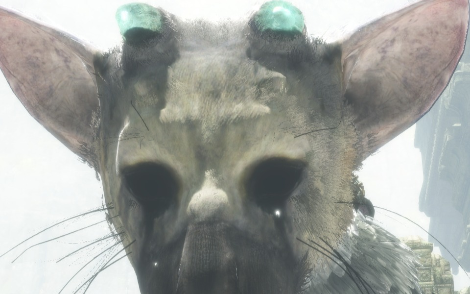
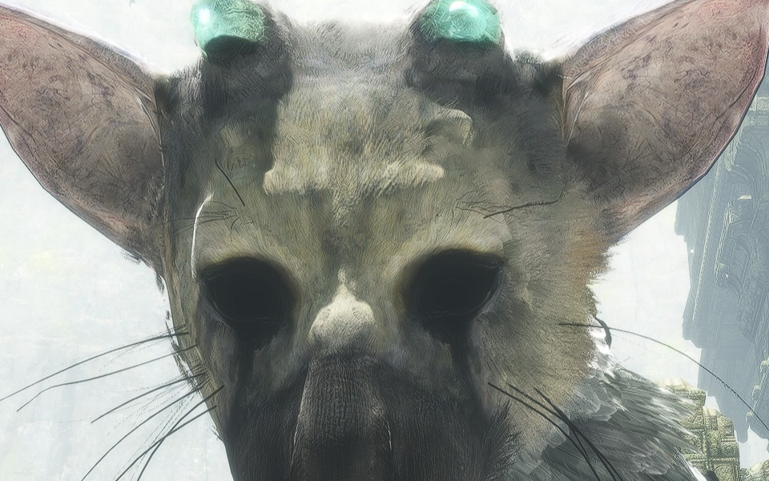
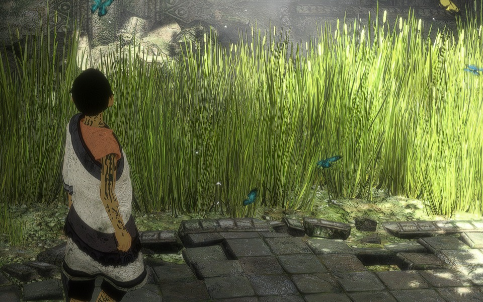
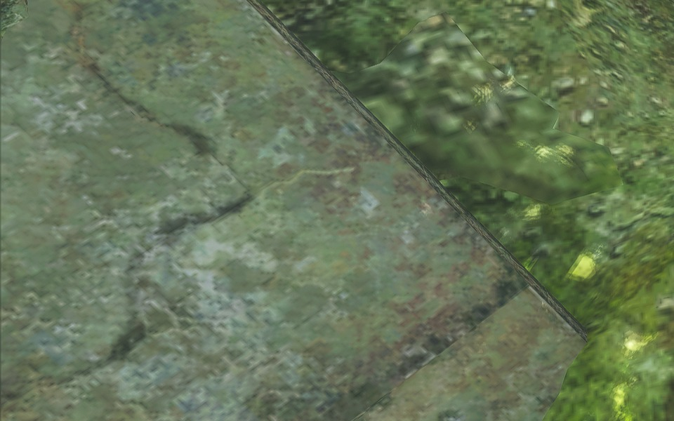
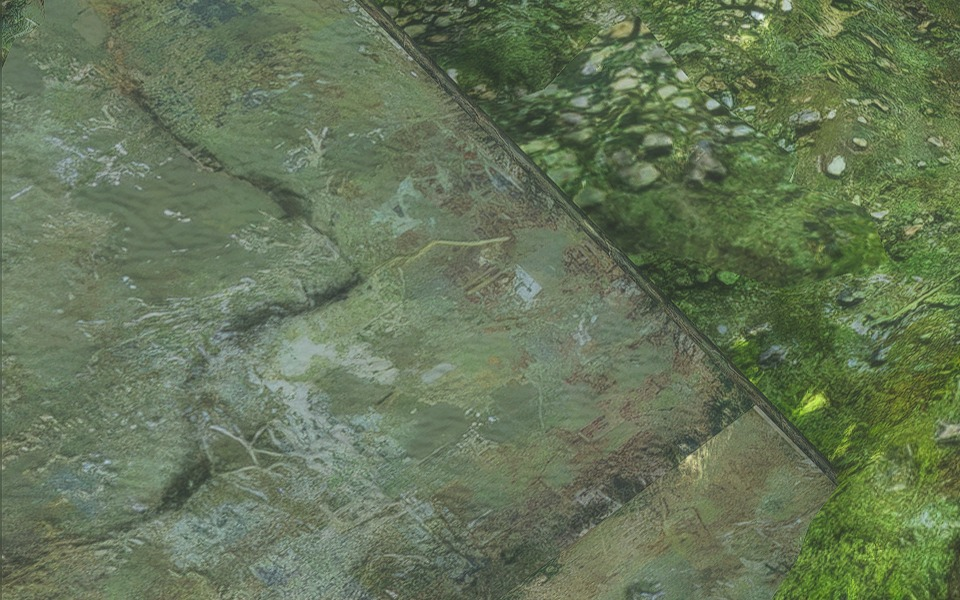
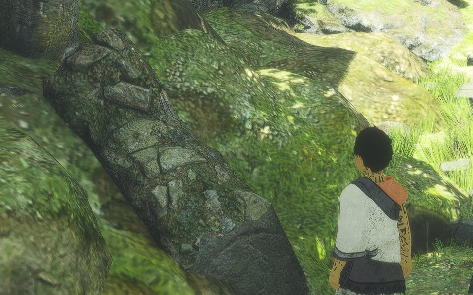
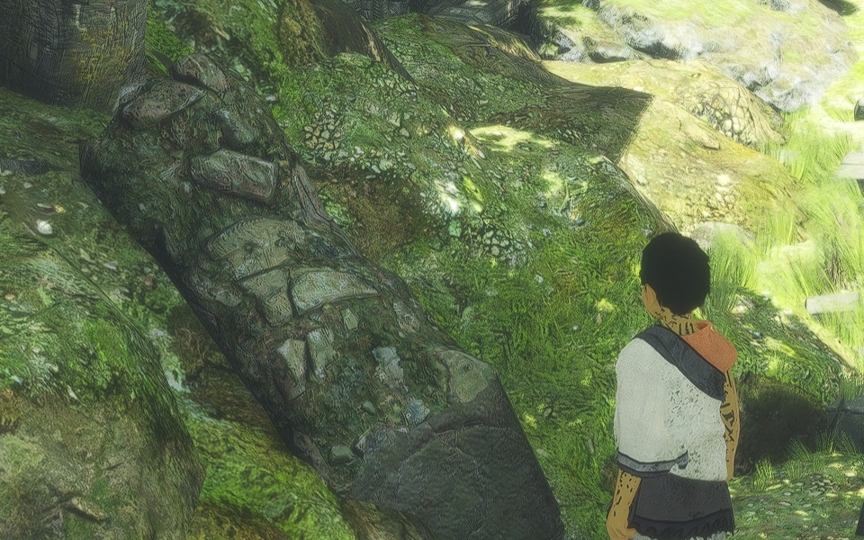

<p align="center"></p>

# The Last Guardian for PC

A native PC port of The Last Guardian (PS4, 1.03) for Windows and Linux. This fork builds on
[HayatoG/tlg_pc](https://github.com/HayatoG/tlg_pc) and concentrates on one thing: making the game
look as good as it can on a PC, without changing what it is.

The port itself, the loader, the runtime and most of what makes the game playable at all, is
HayatoG's work; see their [README](https://github.com/HayatoG/tlg_pc#readme) (Portuguese and
English). Bug fixes made here go back upstream as pull requests.

> No game files are included. You need your own copy, dumped from your own PS4.

## See it in motion

[](https://www.youtube.com/watch?v=16rYLJlGy6A)

## Stock vs modded

Each pair shows the same spot: first the game's own settings, then this fork's defaults (DLAA,
sharpening, color, shadows, effects). Both run in widescreen at 3840x1600, so even the stock
shot is already beyond the PS4. Each scene has a detail at 100% and links to
the full screenshots as PNG.

> These are still images. The biggest changes are in motion: stable edges on foliage, feathers and
> fences, no shimmer, clearer distance. They are transformative, and can only be properly seen in
> game.

### Trico

Full resolution (PNG): [stock](docs/screenshots/TRICO_STOCK.png) · [modded](docs/screenshots/TRICO_AFTER.png)

*Detail at 100%: Trico's face. Stock first, then modded.*

[](docs/screenshots/TRICO_STOCK.png)

[](docs/screenshots/TRICO_AFTER.png)

### Cave

Full resolution (PNG): [stock](docs/screenshots/CAVE_STOCK.png) · [modded](docs/screenshots/CAVE_AFTER.png)

### Cave courtyard

Full resolution (PNG): [stock](docs/screenshots/CAVE2_STOCK.png) · [modded](docs/screenshots/CAVE2_AFTER.png)

*Detail at 100%: grass and the boy. Stock first, then modded.*

[](docs/screenshots/CAVE2_STOCK.png)

[](docs/screenshots/CAVE2_AFTER.png)

### Texture pack

Full resolution (PNG): [original textures](docs/screenshots/TEXTURE_STOCK.png) · [with the texture pack](docs/screenshots/TEXTURE_AFTER.png)

*Detail at 100%: stone slab. Original textures first, then with the texture pack.*

[](docs/screenshots/TEXTURE_STOCK.png)

[](docs/screenshots/TEXTURE_AFTER.png)

*Detail at 100%: moss and rock. Original textures first, then with the texture pack.*

[](docs/screenshots/TEXTURE_STOCK.png)

[](docs/screenshots/TEXTURE_AFTER.png)

## What this fork adds

**DLAA.** NVIDIA's DLSS anti-aliasing at native resolution, fed with the game's own motion vectors.
It replaces the game's SMAA and removes most of the shimmer on foliage, feathers and fences. On by
default on RTX cards. **FSR 3.1 Native AA** does the same with AMD FSR on any card. F8 switches
between the chosen anti-aliasing and the original SMAA. See [docs/dlaa.md](docs/dlaa.md).

**Any resolution and aspect ratio.** The game renders at the window's resolution, including 21:9
and 32:9. At 21:9 the menus, hints and subtitles are laid out for the wider screen instead of
being stretched. 32:9 is experimental: the game runs, but some overlays sit to the left and parts
of the menus are stretched.

**AI-upscaled textures.** [ps4-texturepack-generator](https://github.com/tabnul/ps4-texturepack-generator),
a separate tool, turns the textures of your own copy into a 4x upscaled pack (colour textures and
normal maps). The game loads them while it runs and frees them again when they
are no longer drawn. Runs on NVIDIA, AMD/Intel or, slowly, on the CPU. Entirely optional. See
[docs/texture-pack.md](docs/texture-pack.md).

**Realistic wind, less flicker.** The stock wind can make the boy's hair and clothing, the trees
and Trico's feathers thrash as if in a storm. The game also moves most grass only every 4th frame,
which looks choppy and flickers at PC frame rates. Here the grass moves every frame, and you set
the wind strength separately for the boy, for trees and ivy, and for Trico's feathers. The
recommended 50% looks like a breeze instead of a gale. You can also go calmer, or back to the
original.

**Advanced graphics tweaking, live in game.** Press Insert and change the picture while you play.
Nearly every setting applies on the spot, with no restart and no trip back to the launcher. The
launcher has the same settings, so you can set things up before starting.

- **Presets:** *Stock* (the game exactly as shipped), *Recommended* (the default) and your own.
  Export a preset to a `.json` file and share it; anything specific to your machine is left out.
- **Shadows:** 2048, 4096 or 8192 shadow maps. The higher ones remove most of the shimmer in tree
  and leaf shadows.
- **Camera:** field of view from 50 to 110 degrees.
- **The game's own effects as sliders:** 100% is as shipped and 0% switches the pass off. This
  covers ambient occlusion, bloom, screen space reflections, motion blur, vignette, the game's
  sharpening and fog distance.
- **Wind and foliage:** grass animation (every frame or as shipped), and wind strength for the
  boy, for trees and ivy, and for Trico's feathers.
- **Textures:**
  - texture LOD bias under DLAA, for finer detail on grass and stone;
  - anisotropic filtering up to 16x;
  - live switching between AI-upscaled texture packs.
- **Scaling and sharpening:** FSR 1, plus AMD CAS or RCAS sharpening with adjustable strength.
- **Colour:** brightness, contrast, saturation and gamma of the final image.
- **Output:** HDR10 output through the game's own HDR path.
- **Performance:** frame rate limit, frame queue depth and background shader compilation.
- **Frame rate:** 30 (as on PS4), 60 or unlocked. Unlocked lowers the base frame rate by about
  10 FPS against 60 at the same spot (about 57 vs 48 FPS in our test), so pick 60 unless your PC
  runs well above 60.
- **Menu buttons:** [Cross/Circle confirmation](docs/menu-buttons.md), without swapping gameplay
  buttons. The in-game menu conversion requires the verified EU 01.03 executable.
- **Japanese text (experimental):** on EU CUSA03745 update 01.03, choose **日本語 (EU 1.03 text
  fallback)** in Game language. The embedded-asset fallback moves or deletes no archives. See
  [setup and limitations](docs/japanese.md); this is not Japanese-region disc support.

Every setting shows the value the game originally used. Its help text says what we would pick and
why, and what it costs where we measured it. We tested every candidate setting. The ones that made
no visible difference were left out, and the evidence is in
[docs/graphics-investigation.md](docs/graphics-investigation.md).

**Level select and the game's own QA menu.** The PS4 game still contains the developers' level
select and QA menu. This port can switch both on: tick *Level select and QA menu* under Debug in the
launcher.

- **Level select:** hold L1 while the title menu closes (Continue or New Game) and pick any chapter.
- **QA menu:** in game, hold L1 and press L3 (keyboard: hold 1, press Z). It is the developers' own
  menu, and from there you can jump to any stage.

The idea comes from the GoldHEN "Level Select + QA Menu" patch by illusiony and DanielSvoboda. On
its own, that patch's stage switch leaves a black screen and runs the game out of video memory
after a few jumps. This port fixes both, so you can jump from stage to stage at will, which is
handy for revisiting a favourite area or comparing graphics settings across the game. Both are
off by default.

The GoldHEN *collapsing bridge freeze fix* (same authors) is always on: without it the game can
freeze when the bridge in the pit collapses. It skips the slow motion of that moment.

## Download

Builds of this fork are under [Releases](https://github.com/tabnul/tlg_pc/releases).

## Game files

The port needs **CUSA03627 (US) or CUSA03745 (EU) with update 01.03**: one folder with the base
game and the update's files on top. About 25 GB.

For audio, the PS4 firmware's `libSceNgs2.sprx` goes in `system_lib/` next to the executable.

The full file list is in [docs/game-files.md](docs/game-files.md).

**PC:** a Vulkan 1.3 graphics card with 6 GB of video memory or more. DLAA needs an NVIDIA RTX card; FSR 3.1 Native AA runs on any card.

## Playing

1. Extract the release and put `libSceNgs2.sprx` in `system_lib/`.
2. Start the launcher, pick the game folder and language, and press **Play**.
3. In game: **Insert** (or R3 + L2) opens the port's menu, **F10** shows the frame rate, **F8**
   switches the anti-aliasing (DLAA or FSR 3.1) / SMAA, **Esc** releases the mouse.

Controllers (DualSense, DualShock 4, Xbox) work through SDL3, motion sensor included. Mouse and
keyboard work too and can be remapped. More in
[port/packaging/README-player.md](port/packaging/README-player.md).

## Building

```bash
git clone --recursive https://github.com/tabnul/tlg_pc.git && cd tlg_pc
cd port && TLG_LTO=OFF bash build.sh
```

On Windows this runs in an MSYS2 CLANG64 shell; see
[port/packaging/windows/README.md](port/packaging/windows/README.md). DLAA needs the DLSS SDK as
well (`build_dlss.sh`).

## Credits

- [HayatoG/tlg_pc](https://github.com/HayatoG/tlg_pc) by HayatoG: the port this fork is based on.
- [gow3_pc](https://github.com/FelipePrado0/gow3_pc), [bloodborne_pc](https://github.com/deadinside28/bloodborne_pc)
  and the [shadPS4](https://github.com/shadps4-emu/shadPS4) video core, which the port builds on.
- illusiony and DanielSvoboda for the GoldHEN level select, QA menu and bridge fix patches.
- [kanjieater](https://github.com/kanjieater) for the Cross/Circle menu confirmation and the
  EU 1.03 Japanese text option (upstream PRs #140, #141). Thank you!
- [LibAtrac9](https://github.com/Thealexbarney/LibAtrac9) for audio.
- [4x-UltraSharp](https://huggingface.co/Kim2091/UltraSharp) by Kim2091, the default texture
  upscale model (CC BY-NC-SA 4.0), and Microsoft's
  [DirectXTex](https://github.com/microsoft/DirectXTex) for texture compression.
- NVIDIA DLSS, under the NVIDIA DLSS license.
- [FSR-Vulkan](https://github.com/FireBurn/FSR-Vulkan) by Mike Lothian (@FireBurn), AMD FSR 3.1 and
  FSR 4 on Vulkan, which FSR 3.1 Native AA runs on. Thank you!
- Lucas Emiliano ([@devLucasEmiliano](https://github.com/devLucasEmiliano)) for the start-up fix when
  another program's DLL already sits in the PS4 address range
  ([SpartanPort #1076](https://github.com/FelipePrado0/SpartanPort/pull/1076)). Thank you!

GPL-2.0, see [port/LICENSE](port/LICENSE).

Not affiliated with Sony Interactive Entertainment, SIE Japan Studio or genDESIGN. The Last
Guardian is a trademark of Sony Interactive Entertainment. No game code, files or art are
distributed here.
