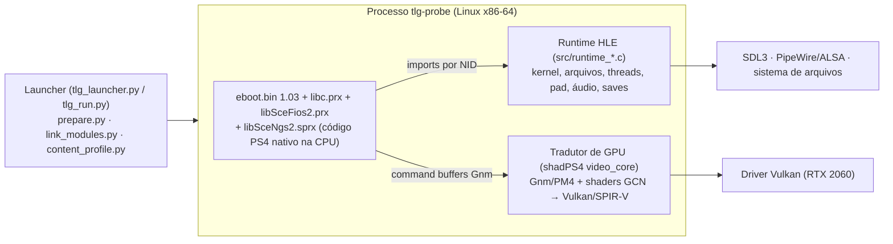

# The Last Guardian PC — Progresso e pendências

Atualizado em 13/10/2026.

## Resumo

The Last Guardian (PS4, CUSA03627, update 1.03) roda no PC com imagem, som, controle e saves, a 30 FPS estáveis, sem emulador de CPU. O código original do jogo roda nativo no processador; o sistema do PS4 é reimplementado (estilo Wine) e a GPU é traduzida para Vulkan.

| Item | Estado |
| --- | --- |
| Boot, menu, intro, gameplay | Funciona; sessões de 10+ minutos sem falhas |
| Imagem | Nativa, sem tremor (FSR3/jitter do port de GoW3 desligados) |
| Áudio | Funciona: NGS2 original do firmware do console |
| Controle | DualSense e 8BitDo via SDL3, com hot-plug |
| Saves | Autosave e Continue funcionam |
| Desempenho | 30 FPS (trava original do jogo); engasgos pontuais de 20 a 70 ms, pouco perceptíveis |
| Launcher | Gráfico, horizontal, pt\_BR e en\_US, com atalho no menu de aplicativos |
| Repositório | Público: [HayatoG/tlg\_pc](https://github.com/HayatoG/tlg_pc) |

Hardware de teste: Ryzen 7 5700X3D, 32 GB de RAM, RTX 2060 6 GB (driver NVIDIA 595), Nobara Linux (Fedora 44).

## O que foi feito

Tudo em 12 e 13 de outubro de 2026, do dump do console até o jogo jogável e publicado. Ordem do mais recente para o mais antigo.

| Etapa | Resultado |
| --- | --- |
| Launcher horizontal com a arte oficial | Banner e ícone lidos do dump do usuário; atalho no menu de aplicativos (`scripts/install_desktop.sh`) |
| Publicação no GitHub | Repositório público, autor com e-mail noreply, sem arquivos do jogo; issue #1 (macOS Apple Silicon) |
| Limpeza pré-publicação | Removidos fonte, ícone, patches, launcher e docs do GoW3 |
| Launcher e núcleo de execução | `tlg_launcher.py` (Tkinter, pt\_BR/en\_US) e `tlg_run.py`; idioma do jogo (en, pt\_BR, es\_LA, fr\_CA) |
| Menu do overlay para o TLG | Abas Overlay, Imagem e Desempenho, bilíngue, com mouse; sem as opções do GoW3 |
| Contador de FPS nativo | F10 liga e desliga; GPU, CPU, RAM e VRAM medidos no Linux |
| Renomeação para TLG | 2.581 ocorrências em 247 arquivos; variáveis `TLG_*`, binário `tlg-probe` |
| Áudio nativo | `libSceNgs2.sprx` do firmware do console linkado como módulo; som na intro e no gameplay |
| Saves e lança do Trico | Leitura curta de textura corrigida; Continue volta ao ponto certo |
| Imagem nativa | FSR3, jitter e motion vectors do GoW3 desligados: o tremor sumiu |
| Readback GPU para CPU | Modo Precise sem deadlocks; entrada no gameplay sem crash |
| Primeiro boot e intro | Menu e cutscene de abertura renderizando na RTX 2060 |
| Loader e runtime | Base gow3\_pc; 54 funções de sistema novas; 391 de 391 imports resolvidos |
| Dump completo | Eboot 1.00 e 1.03, prx e 23 GB de psarc; os 3 maiores que 4 GiB vieram por pendrive |
| Análise do eboot | Ghidra com GhidraOrbis e REA; 4 relatórios (loop/threads, renderização, áudio, I/O) |

## Como funciona

O launcher prepara a imagem do jogo. Dentro do processo, o eboot e os módulos rodam nativos na CPU; só as chamadas de sistema e de GPU passam pelo runtime e pelo tradutor para Vulkan.

## Problemas encontrados e correções

Cada linha é um bug que impedia o jogo de avançar ou estragava a imagem, com a causa e o que foi feito. Endereços do eboot 1.03 com base `0x1000000` (Ghidra).

| Sintoma | Causa | Correção |
| --- | --- | --- |
| psarc de 5,7 a 7,2 GB truncados no dump | FTP do GoldHEN v2.2 calcula tamanhos em 32 bits | Dump via USB (Itemzflow, exFAT); importação verificada contra o FTP |
| Build falhava no Fedora | Zydis só com pkg-config, magic\_enum sem pasta, Vulkan-Headers 1.4.341 | Ajustes no CMake; Vulkan-Headers 1.4.354 como submódulo |
| Crash ao iniciar a GPU na NVIDIA | `VK_KHR_pipeline_binary` no driver 595 | `TLG_PIPELINE_BINARIES=0` (causa raiz em aberto) |
| Assert do tessellation ring buffer | Endereço fixo `0x7f0000000` recusado pelo alocador | Alocador respeita a janela system-reserved |
| Crash no comando gigante de GPU | Dados maiores que um RecordChunk (128 KB) | Gravação passa para o modo direto |
| Crash ao pular a intro | Formato de dados reservado (`data_fmt 15`) | Ignorado, como no hardware real |
| Ponteiro nulo na entrada do gameplay (`0x1c4c570`) | CPU lê resultados de compute da GPU (`AsyncMap`) sem readback | Readback Precise como padrão |
| Deadlock do modo Precise | Threads internas da GPU disparando o próprio readback | Leitura pela visão sem proteção; workers desistem antes do readback |
| Texturas tremendo e piscando | FSR3 e jitter do GoW3; cache de texturas com 2 GB | Imagem nativa; orçamento de 5600 MB |
| Crash após tirar a lança | Leitura curta de textura (assert `JsTex.cpp:459`) com páginas re-protegidas | Leitura em laço até completar |
| Jogo mudo | NGS2 era um placeholder silencioso | Módulo NGS2 nativo do firmware |
| Fechou com erro (código 23) após ~34 min: `buffer.cpp:135` "Failed allocating buffer (size 0x0, memory type 2)" | Imagem de color buffer com extensão zero — hint CB/DB com uma dimensão 0, ou `ColorBuffer::Height()` = 0 quando o slice é menor que uma linha — e o readback de 0 bytes pedia um buffer Vulkan de tamanho 0, que o driver recusa | `CbDbExtent::Valid()` só aceita hint com as duas dimensões; `ColorBuffer::Height()` nunca devolve 0; o readback (`ReadbackSize`) é pulado com aviso quando não cabe na alocação (slice de menos de uma linha); teste `image-extent-test` |

## O que falta

O jogo já é jogável; o que falta é jogar adiante corrigindo o que aparecer, e os extras. Estimativas para uma pessoa.

- [ ] **Jogar o jogo inteiro e corrigir o que quebrar.** Cada área nova pode trazer um shader, formato ou assert novo; o vigia e o dump automático ajudam. Esforço contínuo.
- [ ] **Crash no `EmitVertexBuffers`.** Visto duas vezes (a segunda em 13/10, jogando normalmente, endereço `0x20000`). O `record_chunk` do scheduler estava nulo, o que só acontece dentro de `KickRecording` (entrega o chunk ao gravador e só depois aloca outro). Provável: alguma chamada da thread da GPU (stage A) usa o scheduler sem drenar o draw pipe (stage B). Investigação em andamento.
- [ ] **Empacotamento Linux.** AppImage ou Flatpak com o launcher. Alguns dias.
- [ ] **Remover o código de cheats e hooks do GoW3** (orbs, vida, dano) que ainda está no runtime. Um a dois dias.
- [ ] **60 FPS ou FPS livre.** Comparar o eboot 1.00 (sem trava) com o 1.03 e desfazer a trava; validar física e animações. Dias a semanas.
- [ ] **Readback direcionado.** Aplicar o modo Precise só nos buffers do `AsyncMap` para tirar os engasgos de 20 a 70 ms. Baixa prioridade: não são notados jogando. Dias.
- [ ] **Cache de pipelines na NVIDIA.** Investigar o crash do `VK_KHR_pipeline_binary`. Baixa prioridade.
- [ ] **Build e pacote para Windows.** O código herdado já suporta MSYS2/clang64. Dias.
- [ ] **macOS Apple Silicon.** Rosetta 2 com AVX, TLS sem `gs`, MoltenVK. Semanas a meses ([issue #1](https://github.com/HayatoG/tlg_pc/issues/1)).
- [ ] **FSR ou DLSS integrados ao pipeline do TLG.** Usar o SMAA/TAA do próprio jogo, não o gancho do GoW3. Opcional.

## Referências

Tudo no repositório [HayatoG/tlg\_pc](https://github.com/HayatoG/tlg_pc), exceto os arquivos do jogo e do firmware, que ficam só em `~/decomp/tlg_pc/dump`.

| O quê | Onde |
| --- | --- |
| Abrir o launcher | menu de aplicativos ("The Last Guardian") ou `~/decomp/tlg_pc/tlg_launcher.sh` |
| Rodar pelo terminal | `~/decomp/tlg_pc/run_tlg.sh [segundos]` |
| Compilar | `cd ~/decomp/tlg_pc/port && TLG_LTO=OFF bash build.sh` |
| Logs de cada sessão | `~/decomp/tlg_pc/port/out/logs/` (`last_run.log` = o último) |
| Saves | `~/decomp/tlg_pc/port/user/savedata/` |
| Vigia de sessão | `scripts/watch_session.sh` (dump automático se travar) |
| Opções `TLG_*` | `docs/TECNICO.md`, seção "Opções" |
| Relatórios de análise | `analysis/01_main_loop_threads.md`, `02_rendering_gnm.md`, `03_audio.md`, `04_io_input_saves_system.md` |
| Origem do código | `port/UPSTREAM.md`: [gow3\_pc](https://github.com/FelipePrado0/gow3_pc), [bloodborne\_pc](https://github.com/deadinside28/bloodborne_pc), [shadPS4](https://github.com/shadps4-emu/shadPS4) (GPL-2.0) |
| Port para Mac | [issue #1](https://github.com/HayatoG/tlg_pc/issues/1) |

No jogo: **F10** liga o contador de FPS; **Insert** (ou R3 + L2) abre o menu.
