# Fun

Features you will not find in any other version of the game. The game's files still hold things the
developers built and then cut, hid or kept for themselves: Trico's drool, his throw-up, disco eyes,
a free camera, test menus. We found them in the game's own scripts and brought them back to life,
together with a Trico you can boss around. All of it is optional and off until you use it. Nothing
here changes the story or your save on its own.

Open the in-game menu with **Insert** (or **R3 + L2** on a controller) and go to the **Fun** or
**Trico Tricks** tab.

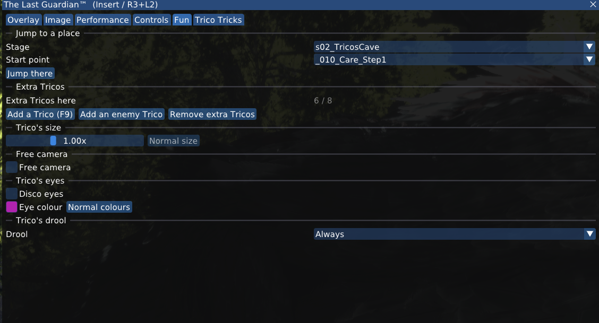

## Contents

- [Trico's drool](#tricos-drool), a feature cut just before release
- [Outfits and ICO horns](#outfits-and-ico-horns)
- [Trico's size](#tricos-size)
- [Extra Tricos](#extra-tricos)
- [Trico's eyes](#tricos-eyes)
- [Free camera](#free-camera)
- [Tricopilot](#tricopilot), the developers' self-driving Trico
- [Trico Tricks: make Trico move](#trico-tricks-make-trico-move)
- [Trico's toilet](#tricos-toilet), something you almost never get to see
- [Jump to a place](#jump-to-a-place)
- [Keys](#keys)

## Trico's drool

The developers gave Trico drool, then switched it off just before release. The drool model, its
material and all the logic are still in the game files. In the script `condorcommonslaver.lua` the
code runs right up to the point where it would show the drool, and then stops:

```lua
	-- 一旦よだれを消してくれということなので消しておく
	do return end
```

*"We've been asked to get rid of the drool for now, so I'm getting rid of it."*

"For now" lasted until this port, which brings it back.

- **Always:** a string of drool hangs from Trico's beak the whole time.
- **As the developers planned:** the drool slowly grows while Trico smells something he wants, a
  smell-pot cart (s04_FirstAntenna and s10_Pit), and fades away when he loses interest. The boy's
  smell bottle was meant to do this too, but it was cut, so the carts are the only trigger.

Set it in the launcher on the **Settings** page, or in game on the Fun tab. A change works at once,
also while you play, and the choice is kept for the next start. Off by default.

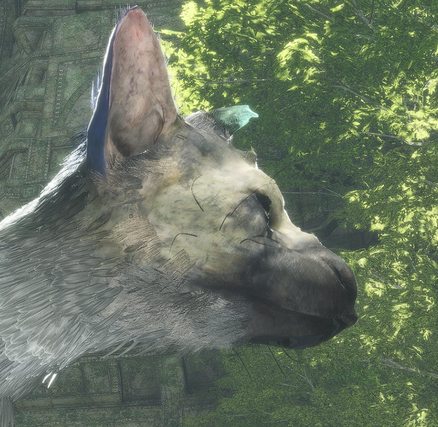
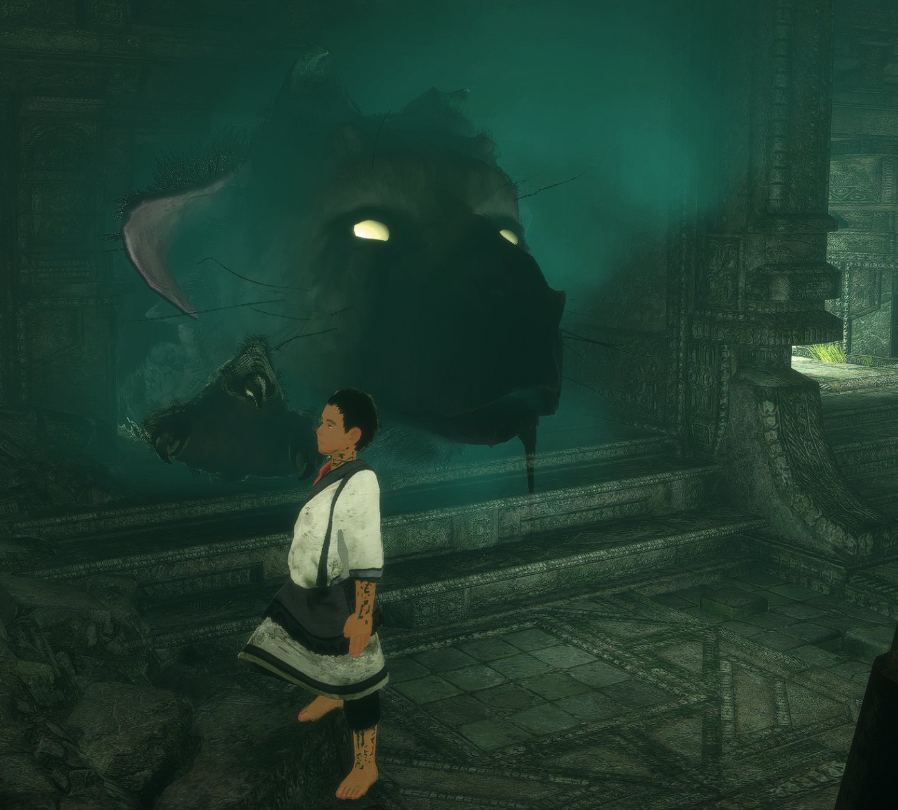

## Outfits and ICO horns

Find the treasures and the boy gets new clothes. Horned Apparel is the Ico one. The script even
calls it "the horned garment", yet there are no horns. So we added them. Tick **ICO horns** in
the launcher's Mods page or in the in-game menu. They go with every outfit. 

We don't ship the horns as a file. The launcher builds them on your PC when you start the game:
a small script draws the shape, the colour and the hair tuft from scratch. Not a single byte comes
from the game disc, and there's no model file to pass around.

<p align="center">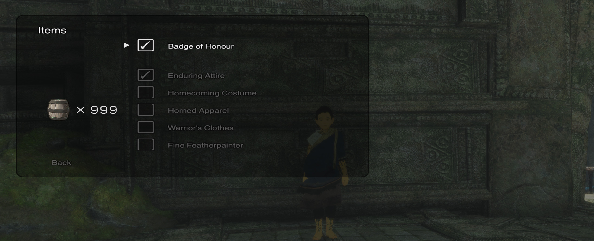</p>

<p align="center">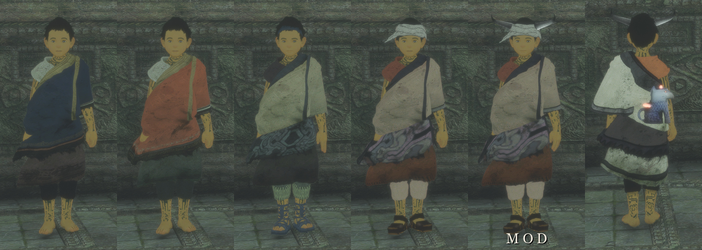</p>

<p align="center"><sub>Enduring Attire · Homecoming Costume · Warrior's Clothes · Horned Apparel · Horned Apparel + ICO horns · the Fine Featherpainter on his back</sub></p>

Trico gets one too: the **Badge of Honour**, around his neck. He may not have earned it yet, but he
sure can wear it in our port.

<p align="center">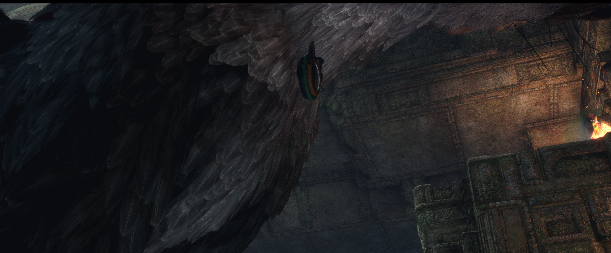</p>

## Trico's size

Makes the story's Trico bigger or smaller, from half to twice his normal size. A big Trico may not
fit through narrow spots: make him normal again (**Normal size**) to pass. A jump or a new stage
brings back his normal size.

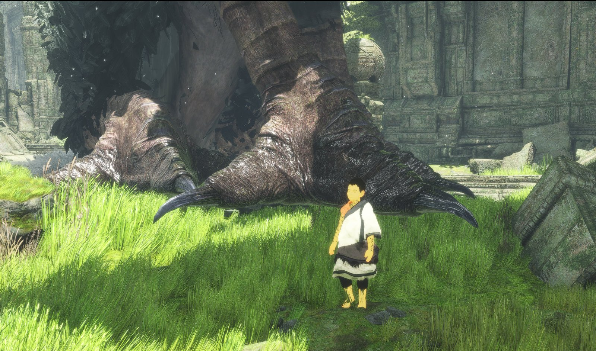
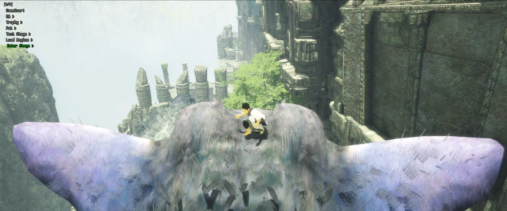
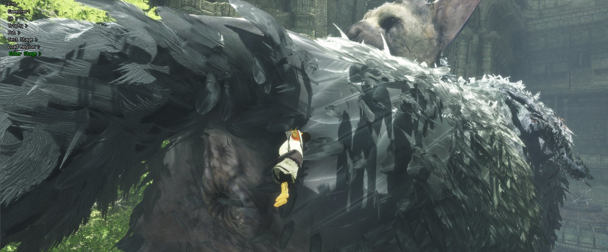
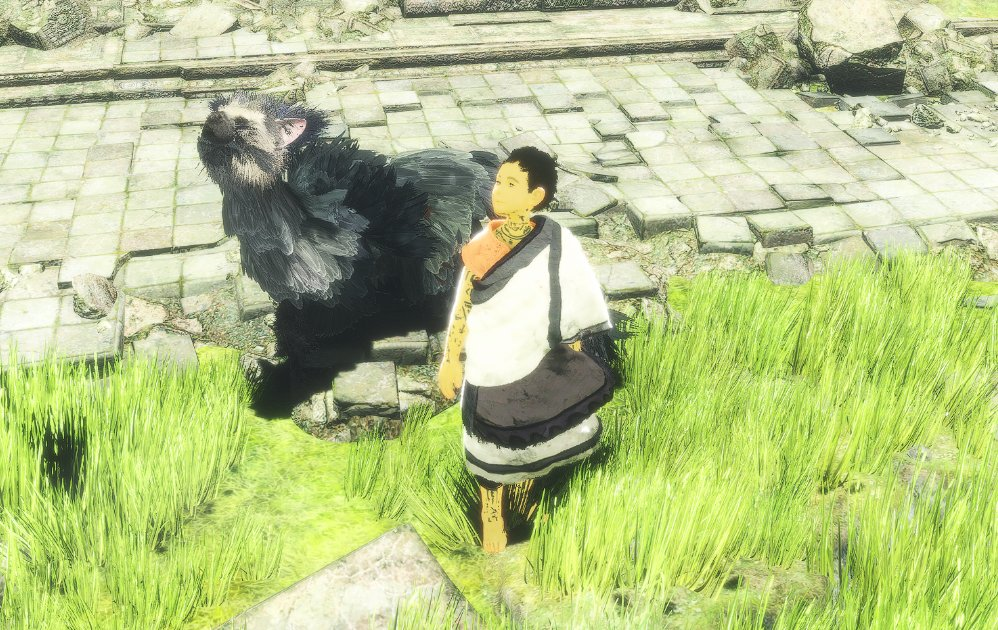
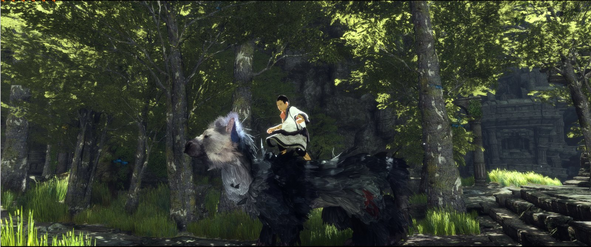
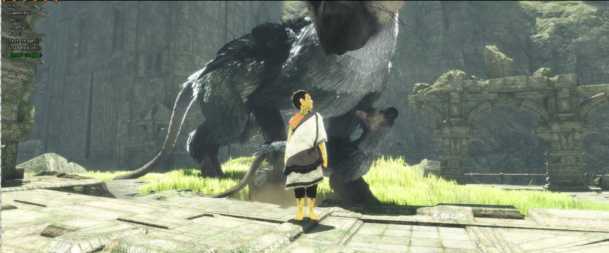

## Extra Tricos

Adds more Tricos next to the boy (**Add a Trico**, or **F9** at any time). **Add an enemy Trico**
brings in the armoured one from later in the story, a bit further away. **Remove extra Tricos**
takes them all away again.

At most 8 extra: with more, the game's physics runs out of room and the game crashes. They are for
fun only: they do not follow the story and can block the way. A jump or another stage ends them.

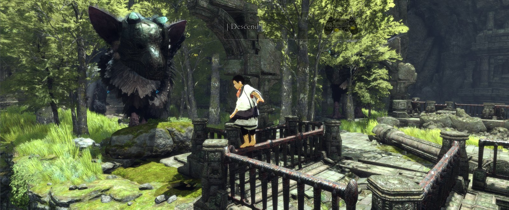

## Trico's eyes

- **Disco eyes:** Trico's eyes keep changing to random colours. This is the game's own hidden
  effect, normally only seen in a few story moments.
- **Eye colour:** pick any colour yourself. **Normal colours** brings the normal eyes back.

A jump turns the effect off.

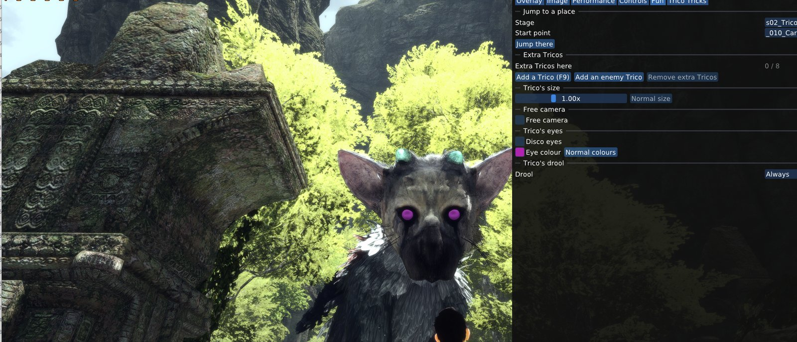

## Free camera

The developers' own camera: it lets go of the normal camera that follows the boy, so you can look
at the scene from anywhere. Turn it off to get the normal camera back. A jump or a new stage turns
it off.

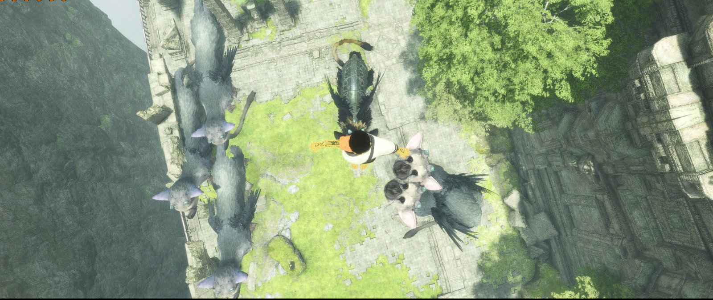

## Tricopilot

**Start Tricopilot** in the **Fun** tab and Trico drives himself: he wanders the scene, looks for
edges to climb or jump, and the camera follows him around. **Stop Tricopilot** gives him and the
camera back to you.

It is not ours. It is the developers' own debug tool, `condordebugautotrico.lua`, still sitting in
the retail game's scripts. They used it to leave the game running by itself for hours while they
watched for crashes: the same file can walk Trico on to the next scene when he is done with this
one, and it knows every stage's start points — their own version of the scene sweep this port uses
for testing. Three leftovers in it say how old it is: a line that restarts the game over a network
socket from a PC called `D:\trico`, a camera preset named `TricoAutoRunTest_middle`, and helper
volumes that are not on the disc any more. The game quietly skips those missing volumes, which is
why Trico sometimes picks an odd route.

**Camera.** The top-down view is the developers' own chase preset, and their tool has three of
them. The **Camera** box next to the Start button picks which one watches him, also while he is
already driving:

- **Near** keeps Trico big in the picture. The best of the four in open scenes.
- **Middle** is what their tool picks itself (`TricoAutoRunTest_middle`): the classic top-down
  view. In a narrow or roofed place the camera can end up inside the rock — in
  s13_FirstFlight `_005_Garden` (mission `FF_b01_EnterGarden`) it does exactly that, while Near
  frames him cleanly.
- **Far** looks down on the whole area. Lovely in a valley, useless indoors: Trico becomes a dot.
- **Game camera** leaves your normal camera alone. It keeps following the boy while Trico wanders
  off on his own.

The game switches the tool off outside the developers' editor, so the port switches it back on
(`DEBUG_AUTO_TRICO`) and waits for Trico to exist before starting him, which is what makes it work
right after a load.

For fun only: Trico ignores the story while he drives, he can wander into water or into a load
trigger, and the story keeps running around him. The launcher's benchmark can keep Tricopilot on
for a whole run (**Debug > Benchmark**, "Let Trico drive"), so the scenes are measured with him
moving instead of standing still. The same four cameras are in the box next to it; the camera only
changes what you see, not what is measured. Those numbers are not comparable with runs without
Tricopilot; the report notes which it was, and which camera.

## Trico Tricks: make Trico move

The **Trico Tricks** tab asks the story's Trico to do things, the same way the game itself does:
sneeze, yawn, roar, howl, flap or stretch his wings, scratch, shake off water, sit, lie down, roll
on the ground and more. He first gets into the pose a move needs (stands up, sits or lies down) and
gets up to 3 tries. His own mind can still win, and some moves need room: a roll can push the boy
off a ledge.

- The moves that worked in our tests are a row of buttons. Press **F12** in game to get the same
  buttons as a small bar over the game, and click a move.
- The drop-down list has every move, also the ones that **may not work**: never seen in our tests,
  or not tested (Groom, Fall asleep, Play in the mud, Dig sand and others). Try them.
- **Gag** and **Throw up:** the throw-up is a cut animation, sealed by the developers in July 2016.
  This brings it back.

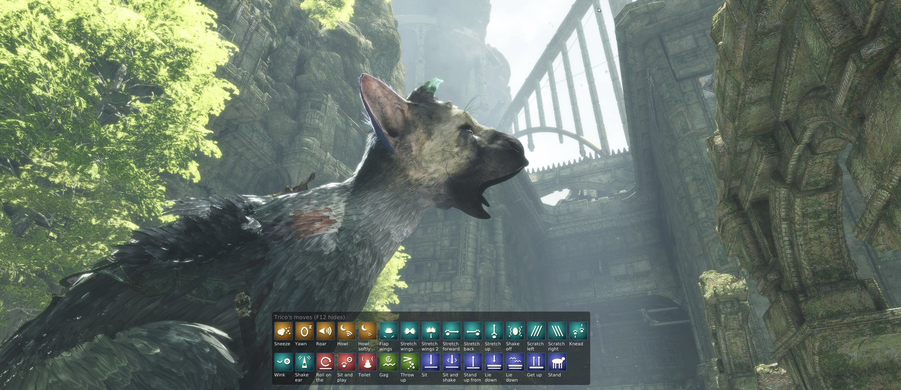

## Trico's toilet

Trico does need the toilet in the game, but the game makes sure you almost never see it. From its
own scripts (`condorcommonactioneatable.lua`, `gamework.lua`), all of these must be true:

- His stomach has emptied at least **2 times** since his last time. That happens after he eats
  barrels: the game counts it as throwing up, even with the throw-up animation cut.
- Then **30 minutes** of normal play pass. Cutscenes and standing in water don't count.
- Then he waits for a moment when the boy is **more than 10 metres away**, there is room, and
  **Trico's head is out of the camera's view for 3 seconds**. Look at him and the wait starts
  over.
- If that moment doesn't come within **10 minutes**, the urge passes and the count starts again.

So in normal play you mostly find the result later, if at all: green dung balls on the ground. The
boy can pick them up and carry them (second picture).

**Toilet** in the Trico Tricks tab skips all of that: he does it right away, in front of you.

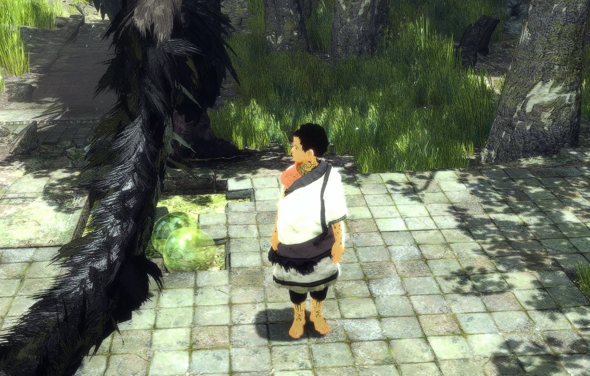
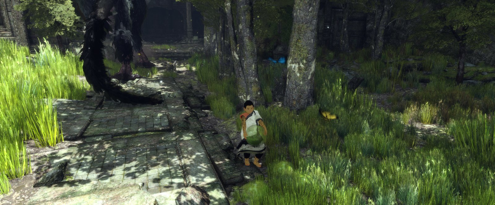

## Jump to a place

Starts any stage at any of its start points, as the game's own level select does.

- **In game (Fun tab):** pick a stage and a start point, then **Jump there**. The story continues
  from there, and the game can save there at its next checkpoint: keep a copy of your save
  (launcher: Saves folder) if you want to go back.
- **In the launcher (Start at…):** starts the game right at the chosen point. Your saves are copied
  before the game starts and put back when it closes, so nothing from that run is kept.

The game's own level select and debug menu (launcher, Settings → Debug) come from the patches of
@illusionyy and @DanielSvoboda. Thank you both.

## Keys

| Key | What it does |
|---|---|
| Insert (R3 + L2) | Opens the in-game menu |
| F9 | Adds a Trico |
| F12 | Shows or hides the Trico Tricks bar |
| F10 | Shows or hides the FPS counter |
