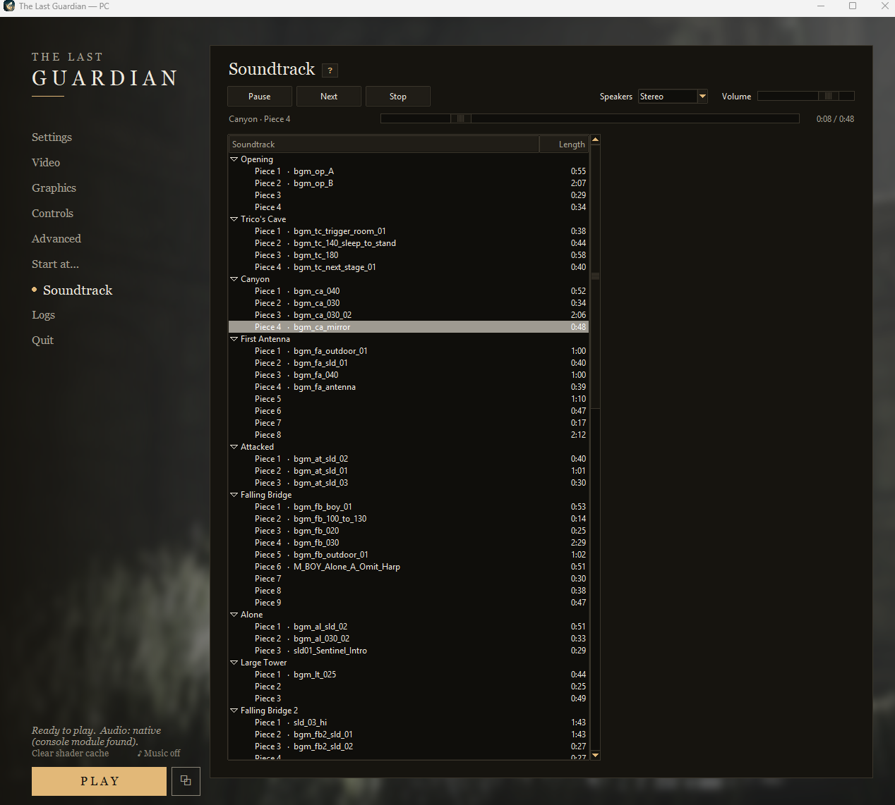

# Soundtrack

The launcher's **Soundtrack** page plays all of the game's music: 100 pieces, about 110 minutes. It
reads them from your own game folder, so nothing of the game is shipped and other language versions
work too. The game has no track titles: each piece is named by the stage it plays in, with the
game's own working name where it has one.

The music is mixed in surround (4 or 6 channels). Choose **Stereo** for two speakers or headphones,
or **5.1 surround** for a surround set. The progress bar lets you skip through a piece.

The sound bank layout comes from [vgmstream](https://github.com/vgmstream/vgmstream). Thank you.

