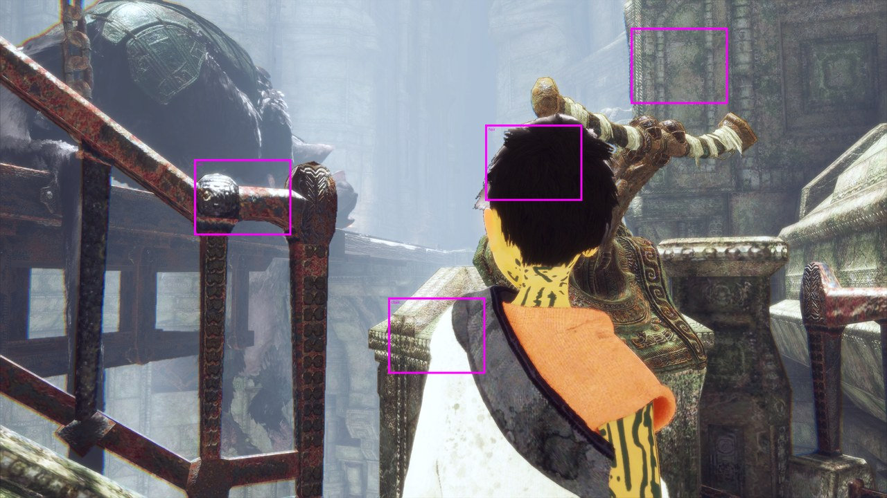
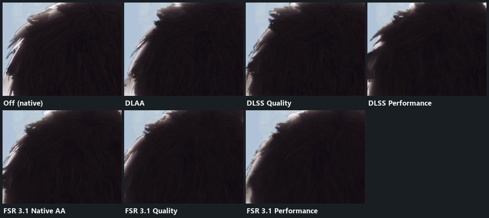
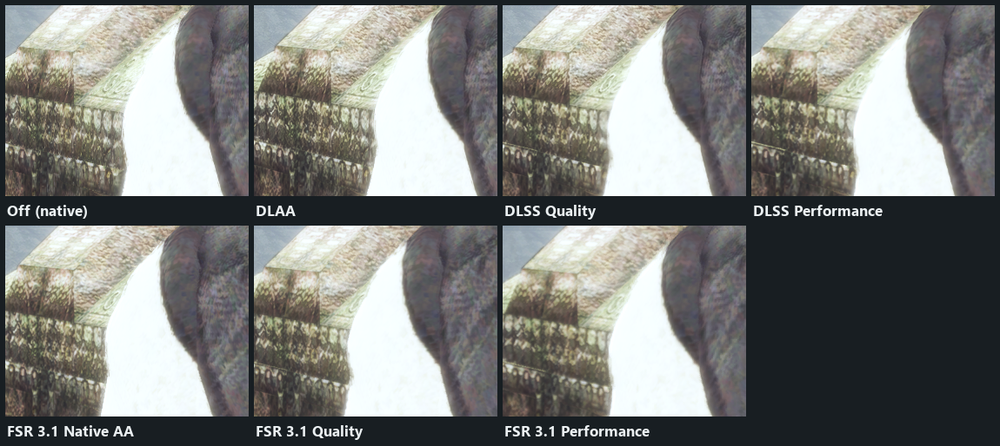
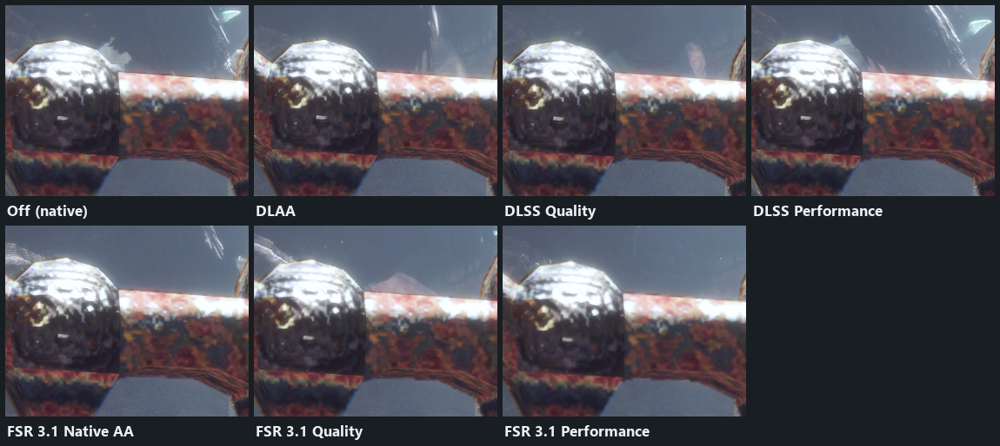
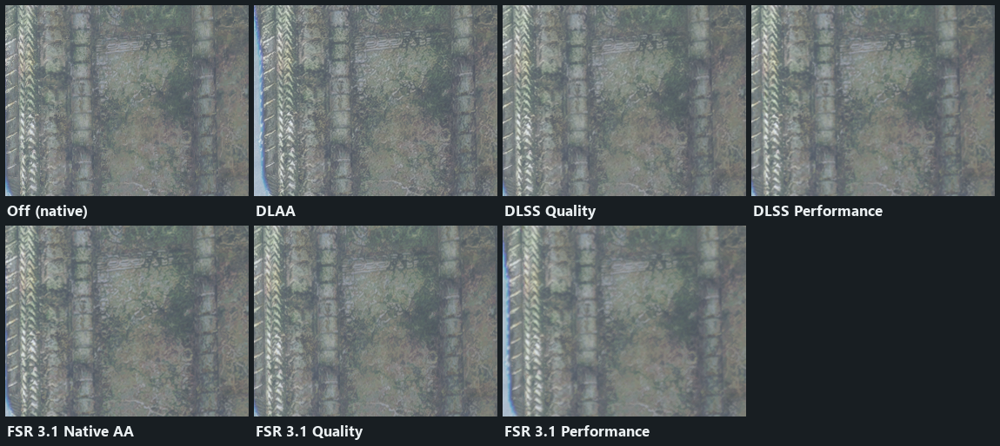
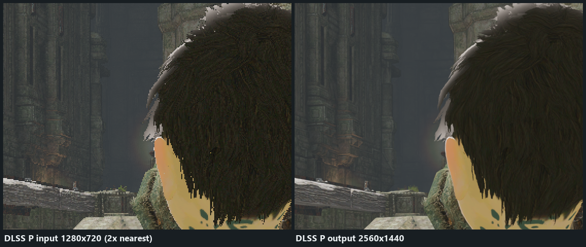
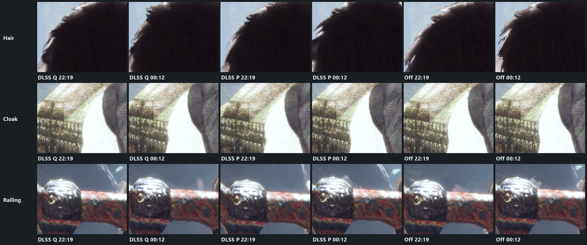
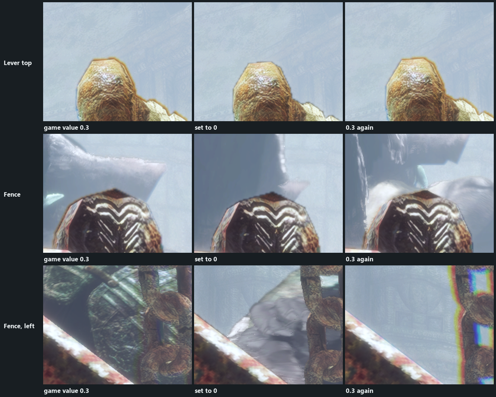
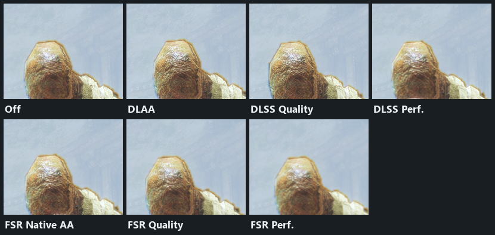

# DLSS / FSR upscaling: status and findings (2026-10-28)

Branch `feat/dlss-upscaling`. Work in progress, not ready to merge. The main open issue is the
vertical stripes in the condor walls (below).

It builds on @HayatoG's scene-resolution proxies (`vk_scene_resolution`), temporal upscaler and
FSR 4 provider. Thanks!

## What it does

One anti-aliasing / upscaling row, in the launcher and the in-game menu (EN/PT):

| Mode | Render size at 2560x1440 output | Share of output pixels |
|---|---|---|
| Off, DLAA, FSR 3.1 Native AA | 2560x1440 | 100% |
| DLSS / FSR 3.1 / FSR 4 Quality | 1708x960 | 44.5% |
| DLSS / FSR 3.1 / FSR 4 Balanced | about 58% per axis | about 34% |
| DLSS / FSR 3.1 / FSR 4 Performance | 1280x720 | 25% |

The ratios are NVIDIA's standard per-axis ratios (Quality 1.5x, Balanced 1.72x, Performance 2x).
The scene renders into reduced proxies of the game's G-buffer. The upscaler writes the native
image into the game's own target at the motion pass, and the post chain runs at native size.
FSR 4 uses 4.1.1 when the driver and assets support it (see `../upscaler.md`). It is built but
untested: it needs AMD RDNA4 hardware.

## Test setup for the images

- Scene: `s14_CondorClash`, gameplay at the lever (mission scene `CH_a01_StartBattle_001`,
  sub-state `subState_Switch_01_upDown`), loaded with CONTINUE from the route `bench` save.
- 2560x1440 Windowed, HDR off, texture pack off, captures of the presented image.
- One camera position, with modes switched live. Only the boy's idle animation moves.
- Images: commit 2f96be38 (00:12), except where a sheet says 22:19 (the first build of that
  night's session). The cleanup commit after it (4d33a394) is meant to change no rendering.
  It ran in the game once, briefly, on 2026-10-28.

## Mode comparison (native pixels, 280x220 crops)

Hair: solid in every mode, no white see-through pixels.

Cloak edge:

Railing:

Wall:

DLSS Performance input (1280x720, enlarged 2x nearest) next to its 2560x1440 output. Both are
scene color before the game's post effects, so they are darker than the screen.

Progress during the session, 22:19 vs 00:12. Off is the control: it did not change, so any
difference there comes from the idle animation.

## Root causes found and fixed

1. **Reduced draws failed the depth test.** Draws with a different vertex shader than their
   depth prepass fail LessEqual at reduced size, so grass and hair showed through (white
   pixels, zero motion). Fix: reduced LessEqual draws with no depth bias, and with no depth write
   or with color targets, get a depth slack towards the camera (`DepthSlackConstant` -16,
   `DepthSlackSlope` -1). Toggle: mask2 bit 16 (`SceneDepthSlack`) turns it off.
2. **The upscaler fell back to native almost every frame.** Native depth writes into the frame's
   G-buffer depth after its motion pass, before the upscale trigger, so DLSS reset or used the
   native fallback. Fix: the depth hold copies the reduced depth at the first native write.
   Check: the log shows `reduced 600, native fallback 0` per 600 upscales. Toggle: mask2 bit 256
   (`DepthHold`).
3. **DLSS Performance looked blocky.** The upscaled image was smooth, but a pass after the
   upscale halved it and a nearest resolve brought it back as 2x2 blocks. Fix: the post chain
   only counts passes that sample the scene (`samples_post_chain`). Passes of the next frame no
   longer count as post passes.
4. **Edges on the boy and cloak.** The fragment sample phase is kept in the packed scene size
   (`SetFragPhase`, mask1 bit 31 turns it off), plus `FragCoordNoisePass` (env
   `TLG_NOISE_PASS=0` turns it off). A still A/B shows no difference between them. A motion A/B
   is still to do, so both stay for now.
5. **Blurry upscale (2026-10-24).** It came from the user ini `lod_bias=2`, not from the
   upscaler. Measure sharpness on dumps with a gradient metric, not by eye.

## The colored rim around the lever and fences

The yellow-brown or green-blue edge is the game's own chromatic aberration in the light-volume
haze (compute shader `8d146043`, `PostProcessSettings.lightVolumeChromaticAberration.x = 0.3`,
radial). It is not DLSS. Setting the value to 0 live through Lua removes the rim, and setting
it back to 0.3 brings it back. It shows at the same strength in Off and in every mode.
Upscaling only makes it easier to see, because the edges around it got sharper.

New setting `haze_fringe` (Effects, "Haze color fringe" / "Franja colorida na névoa"),
0-100%. The default of 100% is the game's original look. It has not been tried in the game yet.

## Acceptance list

| Requirement | Status |
|---|---|
| Upscaling works (reduced input to native output) | Pass |
| DLSS Quality sharp | Close to DLAA in every crop. User's call. |
| Boy edges not blurry | Improved. User's call. |
| Hair cannot be looked through | Pass at the lever shot |
| Foliage reasonably sharp | Not tested: the lever shot has almost no grass |
| Quality to Performance gives more FPS | Not measured. Earlier runs were CPU-bound (Q about P, 52-56 FPS). |
| No regression in DLAA or FSR native AA | Pass at the lever shot |
| **Vertical stripes in the condor walls** | **Open: the user still sees them (2026-10-28)**. Not reproduced in captures. They show on slight camera pans. |
| Colored rim around the lever and fences | Cause found (the game's effect). Setting built, not tested. |
| FSR 3.1 Q/P | Works, softer than DLSS (accepted) |
| FSR 4 | Built, untested (needs AMD) |
| 4K validation, several scenes | Not done |
| Code cleanup | Done in 4d33a394 |

## Open issues and next steps

- Vertical stripes in the condor walls on camera pans. Next step: find the wall and the moment,
  then bisect per draw with `TLG_JITTER_CONTROL` while panning.
- Foliage: S04 `_090_GardenTerrace_001` and the garden.
- 4K validation on several scenes.
- A motion A/B of `SetFragPhase` and `FragCoordNoisePass`.
- An uncapped Q vs P FPS measurement.
- The motion-view debug overlay dispatches the reduced size, so it covers only the top-left
  quarter. Debug only.
- The dead `half_scale` key.
- Crashes: see [crash-family.md](crash-family.md). They don't come from this branch.

## Debug switches

- `TLG_JITTER_CONTROL=<file>`: live per-draw bisection, re-read twice a second (see the comment
  at its parser in `vk_rasterizer.cpp`). Tokens: `lo hi` ranges, `only`, `not`, `skip`, `skipn`,
  `map`, `follow`, `nomesh`, `nodecal`, `halfonly`, `halfnot`, `native`, `bias` / `biasall`,
  `zslack`, `zslackval`, `zbiasnative`, `point`, `slog`. These are debug-only; whether they stay
  in before the merge is still open.
- `TLG_JITTER_DEBUG=1`: logs pixel shaders that disagree with a jittered depth.
- `TLG_SCENE_DEBUG=<file>`: touch the file to log one frame of proxy resolves and reads.
- `TLG_DUMP_TRIGGER` / `TLG_DUMP_DIR`: upscaler input and output dumps.
- `TLG_FRAME_STATS=1`: the upscaler counters (`reduced`, `native fallback`, `depth held`).
- Toggle file (`TLG_TOGGLE_FILE`, "mask1 mask2"): mask1 bit 31 `SetFragPhase`, bit 57
  `SceneMipBias`; mask2 bit 16 `SceneDepthSlack`, 128 `PostReduced`, 256 `DepthHold`.
- The method is described in `.claude/skills/dlss-debug`.
